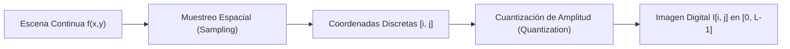
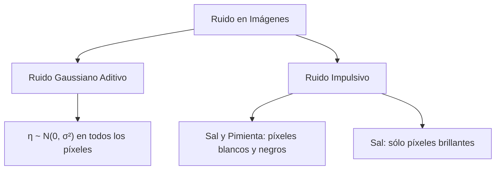
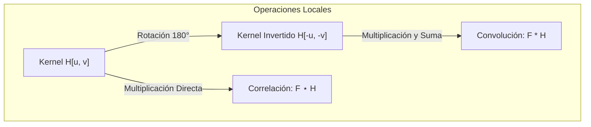
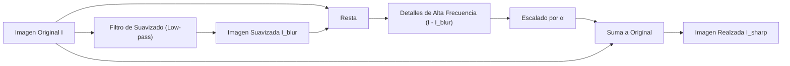
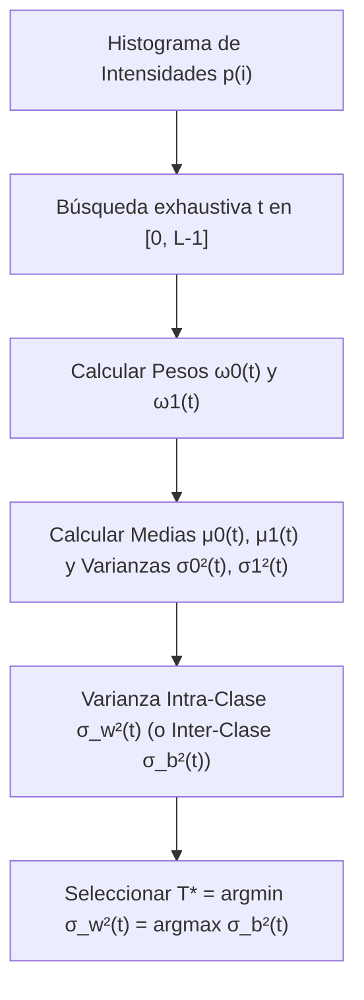

# 1. Representación de Imágenes y Filtrado Lineal

Este documento aborda la formalización del concepto de imagen digital (formación, muestreo y cuantización), los sistemas de coordenadas e indexación en Python/NumPy/OpenCV, la captura de color (filtro de Bayer), los modelos de ruido, los fundamentos algebraicos de la correlación cruzada y la convolución en sistemas lineales e invariantes al desplazamiento (LSI), las condiciones de contorno (*padding* y modos *full/same/valid*), el catálogo de filtros lineales básicos, el realce mediante *Unsharp Masking*, y los operadores no lineales y globales (Filtro de Mediana, Umbralizado y Algoritmo de Otsu, Ecualización de Histograma). Cierra con una advertencia metodológica sobre **operación vs visualización**.

> [!info] Correspondencia con el material de clase
> Este bloque corresponde a las transparencias **T2.1 (Image Representation and Filtering)** y a parte del **PDF de apoyo T2**. Lecturas recomendadas en clase: Szeliski (2022), caps. 2 y 3; Forsyth & Ponce (2012), cap. 4.

---

## 1. Fundamentos de la Imagen Digital

### ¿Qué es una imagen?
Desde el punto de vista físico intervienen tres elementos: la **iluminación** (la luz que llega a la escena), la **reflectancia de las superficies** (cómo absorben, reflejan o dispersan esa luz) y la **respuesta del sensor** (que mide parte de la radiación que le llega). Una cámara digital sustituye la película por una matriz de fotodiodos (CCD o CMOS) que convierten fotones en electrones; la señal se digitaliza y da lugar a los valores numéricos de la imagen.

Hay varias definiciones posibles:
- Un registro de los rayos de luz que rebotan en la escena y alcanzan el sensor (formación).
- La respuesta de nuestras retinas a un estímulo luminoso (biológica; recibimos dos imágenes y el cerebro reconstruye la escena 3D).
- **La que usaremos en la asignatura:** una **rejilla (matriz) de valores de píxel**. En escala de grises, enteros de un byte: $0$ = negro, $255$ = blanco.

### La imagen como función
Una imagen en escala de grises puede verse como una función $f: \mathbb{R}^2 \to \mathbb{R}$ donde $f(x,y)$ es la intensidad en $(x,y)$. Es útil imaginarla como un **paisaje tridimensional** de valles y montañas donde la altura es la intensidad (esta visualización será clave para entender derivadas y bordes). Como con cualquier función, podemos aplicarle operadores:
- **Globales / puntuales:** $g(x,y) = f(x,y) + 20$ (aclarar); $g(x,y) = f(-x,y)$ (reflejar respecto al eje $Y$ si el origen está en el centro).
- **Locales:** la **convolución**, el operador central de este tema.

Una **imagen digital** es una versión discreta de esa función. Para obtenerla se aplican dos procesos de discretización:



1. **Muestreo Espacial (*Sampling*):** Discretización del dominio continuo $(x,y)$ mediante una retícula regular de paso $\Delta x, \Delta y$. Cada elemento es un **píxel** (*picture element*).
2. **Cuantización de Amplitud (*Quantization*):** Mapeo de la irradiancia continua a un conjunto finito de $L$ niveles (redondeo al entero más cercano). Con $b$ bits por píxel:
   $$ L = 2^b \quad \text{niveles de intensidad (típicamente } b=8 \implies [0, 255]\text{)} $$

> [!warning] Trabajamos con una representación aproximada de la realidad
> Por el muestreo y la cuantización, una imagen digital es siempre una representación **ruidosa e inexacta** de la escena, tanto en intensidad como en espacio.

> [!tip] Enteros para almacenar, coma flotante para procesar
> Las imágenes se almacenan como enteros (`uint8`), pero las operaciones se realizan en **coma flotante** para no perder precisión en los resultados intermedios (por ejemplo, derivadas negativas o superiores a 255). Para visualizar se vuelve a cuantizar y recortar al rango permitido. Véase la §10 sobre operación vs visualización.

---

## 2. Sistemas de Coordenadas e Indexación en Python/NumPy

Uno de los errores más frecuentes proviene de confundir el **sistema de coordenadas cartesiano** con la **indexación matricial**:

```text
    (x=0, y=0) ─────── Coordenada X (Columnas, Ancho W) ───────>
        │      (columna 0)      (columna 1)     ...     (columna W-1)
        │    ┌───────────────┬───────────────┬───────┬───────────────┐
  Coordenada │ Fila 0        │               │       │               │
      Y      ├───────────────┼───────────────┼───────┼───────────────┤
  (Filas,    │ Fila 1        │               │       │               │
   Alto H)   ├───────────────┼───────────────┼───────┼───────────────┤
        │    │ ...           │               │       │               │
        │    ├───────────────┼───────────────┼───────┼───────────────┤
        v    │ Fila H-1      │               │       │  I[H-1, W-1]  │
             └───────────────┴───────────────┴───────┴───────────────┘
```

> [!info] Comparación de Notaciones
> - **Geométrica / Matemática:** $(x, y)$, donde $x$ es el desplazamiento horizontal hacia la derecha e $y$ el vertical **hacia abajo**. En procesamiento de imágenes el origen $(0,0)$ está en la **esquina superior izquierda** (no en el centro como en el plano cartesiano).
> - **Matricial en NumPy:** `img[fila, columna]` $\equiv$ `img[y, x]`. El primer eje es el vertical (alto $H$) y el segundo el horizontal (ancho $W$). Los índices empiezan en $0$.

### Imágenes en Color y Canales
Una imagen en color es un campo vectorial $\mathbf{I}: \mathbb{Z}^2 \to \mathbb{R}^C$ con $C=3$ para RGB: puede interpretarse como **tres imágenes en escala de grises**, una por canal, donde valores altos indican mayor contribución de ese color.

```python
import cv2
im = cv2.imread(filename)                    # OpenCV carga en orden BGR
im = cv2.cvtColor(im, cv2.COLOR_BGR2RGB)     # reordenar a RGB
im = im / 255                                # uint8 [0,255] -> float [0,1]

# im.shape -> (H, W, 3)
im[0, 0, 0]          # canal R del píxel superior izquierdo
im[y, x, c]          # fila y, columna x, canal c
im[H-1, W-1, 2]      # canal B del píxel inferior derecho
```

> [!warning] OpenCV almacena en BGR
> `cv2.imread` devuelve los canales en orden **BGR**, no RGB. Hay que reordenarlos antes de mezclar con Matplotlib u otras bibliotecas.

### Captura del color: el filtro de Bayer
Capturar color con tres sensores independientes (cámaras *three-CCD*) es caro. La solución habitual es **un único sensor** cubierto por un **filtro de Bayer** (patentado en 1976): cada fotosensor mide un solo color, en bloques $2\times2$ **RGGB** (50 % verde, 25 % rojo, 25 % azul). Los dos canales restantes de cada píxel se estiman a partir de los vecinos mediante **demosaicing** (interpolación cromática). Hay el doble de verdes porque el sistema visual humano es especialmente sensible a la luminancia, a la que el verde contribuye más (los conos M y L tienen su pico en el verde y el amarillo-verde).

> [!tip] Conversión Estándar a Escala de Grises (Luminancia)
> La conversión a gris no es un promedio simple, sino una combinación ponderada (estándar ITU-R BT.601):
> $$ Y = 0.2989 \, R + 0.5870 \, G + 0.1140 \, B $$
>
> > [!info] Leyenda Matemática
> > - $Y$: Luminancia escalar resultante.
> > - $R, G, B$: Intensidades de los canales rojo, verde y azul.

### Filtrar una imagen en color
OpenCV **no convierte a gris automáticamente**: `GaussianBlur`, `filter2D` y `Sobel` aplican el **mismo kernel a cada canal por separado** ($R \to R'$, $G \to G'$, $B \to B'$). Para suavizar se suele conservar el color; para detectar bordes la opción clásica más simple es convertir primero a gris, porque Sobel sobre RGB da tres $G_x$ y tres $G_y$ y no existe "el" gradiente de color.

---

## 3. Modelos de Ruido en Imágenes

Durante la captura, amplificación y conversión analógico-digital se incorporan perturbaciones estocásticas denominadas **ruido**.



### A. Ruido Gaussiano Aditivo
El ruido de lectura y térmico puede aproximarse mediante un modelo gaussiano aditivo. Las fluctuaciones del número de fotones se describen originalmente mediante ruido de Poisson, dependiente de la señal; no todo ruido de captura es gaussiano ni independiente de la intensidad. Aquí usamos la aproximación aditiva de clase:
$$ I(x, y) = f(x, y) + \eta(x, y), \quad \eta \sim \mathcal{N}(0, \sigma^2) $$

> [!info] Leyenda Matemática
> - $I(x, y)$: Señal ruidosa observada.
> - $f(x, y)$: Señal ideal subyacente.
> - $\eta(x, y)$: Variable aleatoria i.i.d. con media nula y varianza $\sigma^2$.

### B. Ruido Impulsivo: Sal y Pimienta (*Salt & Pepper*)
Aparición aleatoria de píxeles con valores muy diferentes a su entorno (errores de transmisión, fotodiodos defectuosos). Si hay valores claros y oscuros es *sal y pimienta*; si sólo claros, *ruido de sal*:
$$ I(x, y) = \begin{cases} 0 \quad (\text{pimienta}) & \text{con probabilidad } p/2 \\ 255 \quad (\text{sal}) & \text{con probabilidad } p/2 \\ f(x, y) & \text{con probabilidad } 1 - p \end{cases} $$

> [!important] Distintos ruidos requieren distintos filtros
> El filtro de **media** y el **gaussiano** funcionan bien contra el ruido gaussiano (las fluctuaciones positivas y negativas se compensan al promediar). Contra el ruido impulsivo el promedio falla (el valor extremo contamina la media) y hay que usar el **filtro de mediana** (§9). No existe un filtro válido para todo tipo de ruido.

---

## 4. Filtrado Lineal: Correlación Cruzada vs. Convolución

**Filtrar** es formar una nueva imagen cuyos píxeles son una combinación de los píxeles originales. Sirve para extraer información (bordes → forma), mejorar la imagen (quitar ruido, afilar), detectar patrones (*template matching*) y es el operador clave de las **redes neuronales convolucionales**.

### ¿Por qué un vecindario local?
Modificamos cada píxel en función de su **vecindario local** (ni píxeles aislados ni la imagen entera) porque los píxeles cercanos muestran fuerte dependencia estadística, mientras que la relación con píxeles lejanos es más débil y variable. Un píxel aislado y descontextualizado **no vale nada**: lo relevante es la relación entre píxeles. Prueba: una cebra con sus píxeles reordenados aleatoriamente conserva exactamente los mismos valores y es irreconocible.

### Filtrado lineal
Cada píxel de salida es una **combinación lineal (suma ponderada)** de su vecindario. Los pesos se organizan en una pequeña matriz: **kernel**, **máscara** o **filtro**. Se llama *kernel* porque está en el **núcleo** de la operación (sus coeficientes determinan cómo se combina el vecindario); no tiene relación con el núcleo de una aplicación lineal en álgebra.

> [!example] Ejemplo de clase
> Vecindario $\begin{bmatrix} 10 & 5 & 3 \\ 4 & 6 & 1 \\ 1 & 1 & 8 \end{bmatrix}$ y kernel $\begin{bmatrix} 0 & 0 & 0 \\ 0 & 0.5 & 0 \\ 0 & 1 & 0.5 \end{bmatrix}$: $6 \cdot 0.5 + 1 \cdot 1 + 8 \cdot 0.5 = 8$. El píxel central pasa de $6$ a $8$.

Un operador $L$ es **lineal** si y sólo si $L(af + bg) = aL(f) + bL(g)$, lo que combina **homogeneidad** ($L(af) = aL(f)$) y **aditividad** ($L(f+g) = L(f) + L(g)$): el principio de superposición.

### Correlación Cruzada ($G = F \star H$)
Producto escalar deslizante entre el kernel $H$ y el parche de la imagen centrado en $(i, j)$:

$$ G[i, j] = (F \star H)[i, j] = \sum_{u=-k}^k \sum_{v=-k}^k F[i+u, j+v] \, H[u, v] $$

> [!info] Leyenda Matemática
> - $G[i, j]$: Píxel resultante en la fila $i$, columna $j$.
> - $F$: Imagen de entrada.
> - $H$: Kernel de dimensiones $(2k+1) \times (2k+1)$, con índices locales $u, v \in [-k, k]$ y centro en $(0,0)$.

> [!tip] ¿Por qué los kernels son de tamaño impar?
> Para que exista una **posición central bien definida** y los píxeles a ambos lados contribuyan simétricamente. Con tamaño par no hay centro único y hay que decidir a cuál de las dos posiciones se asocia el resultado, lo que introduce un desplazamiento espacial.

> [!example] Índices en detalle (T2.1, slide 76)
> Con $H = \begin{bmatrix} -1 & 0 & 1 \\ -2 & 0 & 2 \\ -1 & 0 & 1 \end{bmatrix}$ y $F = \begin{bmatrix} 1 & 4 & 7 \\ 2 & 5 & 8 \\ 3 & 6 & 9 \end{bmatrix}$ con *zero padding*: $G[0,0] = 0\cdot1 + 2\cdot4 + 1\cdot5 = 13$ (parte del kernel cae fuera) y $G[1,1] = -1 + 7 - 4 + 16 - 3 + 9 = 24$ (kernel completamente dentro). Lo importante no es memorizar índices, sino la intuición: centrar el kernel, multiplicar elemento a elemento, sumar, asignar al píxel central.

### Convolución Bidimensional ($G = F * H$)
Idéntica a la correlación, salvo que **el kernel se invierte espacialmente (se rota 180°: de arriba abajo y de derecha a izquierda)** antes de la suma ponderada:

$$ G[i, j] = (F * H)[i, j] = \sum_{u=-k}^k \sum_{v=-k}^k F[i-u, j-v] \, H[u, v] = \sum_{u=-k}^k \sum_{v=-k}^k F[i+u, j+v] \, H[-u, -v] $$



> [!example] Convolución 1D paso a paso (S. Birchfield)
> Señal $[8, 24, 48, 32, 16]$ y kernel $[\tfrac14, \tfrac12, \tfrac14]$ (simétrico: rotarlo no lo cambia, luego aquí convolución y correlación coinciden). Extendemos los bordes por **replicación** (un $8$ a la izquierda, un $16$ a la derecha):
> - $\tfrac14(8) + \tfrac12(8) + \tfrac14(24) = 12$
> - $\tfrac14(8) + \tfrac12(24) + \tfrac14(48) = 26$
> - $\tfrac14(24) + \tfrac12(48) + \tfrac14(32) = 38$
> - $\tfrac14(48) + \tfrac12(32) + \tfrac14(16) = 32$
> - $\tfrac14(32) + \tfrac12(16) + \tfrac14(16) = 20$
>
> Resultado: $[12, 26, 38, 32, 20]$. Desplazamos el kernel y en cada posición calculamos una suma ponderada del vecindario.

### El experimento del impulso (T2.1, slides 27–69)
Sea $F$ una imagen $3\times3$ con un único $1$ en el centro (señal **impulso**) y $H = \begin{bmatrix} 1 & 2 & 3 \\ 4 & 5 & 6 \\ 7 & 8 & 9 \end{bmatrix}$:
- **Correlación $F \star H$:** la salida es $H$ **rotado 180°**. Intercambiando los operandos ($H \star F$) se obtiene $H$ sin rotar: **la correlación no es conmutativa**.
- **Convolución $F * H$:** la salida es exactamente $H$. E intercambiando operandos también: **la convolución es conmutativa**.

> [!important] El impulso es el elemento identidad de la convolución
> $$ \delta * h = h $$
> Convolucionar un kernel con un impulso devuelve el propio kernel: es el resultado "natural". La correlación devuelve el kernel rotado. Esta es la razón por la que la convolución, y no la correlación, es la operación de referencia en teoría de sistemas.

### ¿Por qué rotar 180° el kernel?
La inversión del kernel dota a la convolución de propiedades algebraicas que la correlación **no** posee:

| Propiedad | Convolución ($F * H$) | Correlación ($F \star H$) | Relevancia |
| :--- | :---: | :---: | :--- |
| **Conmutativa** | $f * g = g * f$ | $f \star g \ne g \star f$ | Conceptualmente no hay diferencia entre filtro y señal: ambos son señales. |
| **Asociativa** | $f * (g * h) = (f * g) * h$ | No | **Permite representar una cadena de filtros por un único filtro equivalente.** |
| **Distributiva** | $f * (g + h) = f * g + f * h$ | Sí | Permite descomponer filtros aditivamente (p. ej. *unsharp masking*). |
| **Escalares** | $(ka) * b = a * (kb) = k(a * b)$ | Sí | Las constantes salen fuera. |
| **Identidad** | $a * \delta = a$ | $\delta \star a = \operatorname{rot180}(a)$ | El impulso unidad $e = [0, 0, 1, 0, 0]$. |
| **Simetría Central** | Si $H[u, v] = H[-u, -v]$ | $F \star H = F * H$ | Coinciden en filtros simétricos (gaussianas, Laplaciano); difieren en los antisimétricos (derivadas). |

> [!warning] Asociatividad no implica ahorro de cómputo
> Precalcular $h_1 * h_2$ no reduce los FLOPs: dos kernels $3\times3$ consecutivos cuestan $18$ multiplicaciones/píxel; el equivalente *full* es $5\times5$ y cuesta $25$. La ventaja es conceptual (un único sistema), de accesos a memoria (menos pasadas) y de libertad de implementación. El ahorro real aparece cuando se explota estructura adicional como la **separabilidad** ([[2. Gaussianas y Bordes]]).

> [!tip] ¿Cuándo usar cada una?
> - **Correlación:** medida de **similitud** entre dos señales. Natural para *template matching* (comparar la imagen con un patrón): no requiere rotar el kernel.
> - **Convolución:** **filtrado lineal** (calcular el efecto de un filtro sobre una señal). Propiedades conmutativa y asociativa que facilitan analizar y combinar sistemas.

### Nota técnica: ¿qué hace realmente la biblioteca?
> [!warning] `cv2.filter2D` aplica correlación, no convolución
> Usa el kernel tal cual, sin rotarlo. `scipy.signal.convolve2d` sí lo rota. Para obtener una convolución con OpenCV, rota el kernel previamente:
> ```python
> cv2.filter2D(im, -1, cv2.flip(fil, -1), borderType=cv2.BORDER_CONSTANT)
> # equivale a
> sp.convolve2d(im, fil, mode='same')
> ```
> (También deben coincidir las condiciones de contorno.) No es que una biblioteca lo haga "bien" y otra "mal": hay que **leer la documentación** y saber qué definición implementa cada función. `cv2.filter2D` con `ddepth=-1` devuelve el mismo tipo que la entrada.

```python
import scipy.signal as sp
import numpy as np
import cv2

image  = np.array([[0,0,0],[0,1,0],[0,0,0]], dtype=np.uint8)   # impulso
filter = np.array([[1,2,3],[4,5,6],[7,8,9]], dtype=np.uint8)
print(sp.convolve2d(image, filter, mode='same'))                              # -> filter
print(cv2.filter2D(image, -1, filter, borderType=cv2.BORDER_CONSTANT))        # -> filter rotado 180°
print(cv2.filter2D(image, -1, cv2.flip(filter, -1), borderType=cv2.BORDER_CONSTANT))  # -> filter
```

---

## 5. Condiciones de Contorno (*Boundary Issues*) y Relleno (*Padding*)

Cuando el kernel de tamaño $(2k+1) \times (2k+1)$ se sitúa sobre un píxel próximo al borde, parte de su soporte cae fuera de la imagen.

### Modos de Salida según Soporte
Dada una imagen $F$ de dimensiones $H \times W$ y un filtro de tamaño $K_h \times K_w$:
1. **Valid:** Sólo se evalúan posiciones donde el kernel cabe completamente. No requiere padding, pero la salida es más pequeña (y convoluciones repetidas la encogen drásticamente).
   $$\text{Dimensiones: } (H - K_h + 1) \times (W - K_w + 1)$$
2. **Same:** La salida conserva las dimensiones $H \times W$. Requiere padding $p = \lfloor K/2 \rfloor$. (Según la implementación, si el kernel es mayor que la señal, "same" puede significar "mismo tamaño que el primer argumento".)
3. **Full:** Se evalúa en cualquier posición con al menos 1 píxel de solapamiento.
   $$\text{Dimensiones: } (H + K_h - 1) \times (W + K_w - 1)$$

> [!example] Imagen $3\times3$ y kernel $3\times3$
> *Full* → $5\times5$; *same* → $3\times3$; *valid* → $1\times1$ (una sola posición donde el kernel cabe). Imagen $10\times10$ y kernel $3\times3$ en *valid* → $10-3+1 = 8 \implies 8\times8$.

```text
                      Modos de Convolución
  ┌───────────────────────────────┐
  │         FULL                  │
  │   ┌───────────────────────┐   │
  │   │     SAME              │   │
  │   │   ┌───────────────┐   │   │
  │   │   │    VALID      │   │   │
  │   │   │ (Sin padding) │   │   │
  │   │   └───────────────┘   │   │
  │   └───────────────────────┘   │
  └───────────────────────────────┘
```

### Estrategias de Relleno (*Padding*)
Para una señal `abcdefgh`, OpenCV ofrece (`borderType`):

| Estrategia | OpenCV | Extensión | Comentario |
| :--- | :--- | :--- | :--- |
| **Zero-padding / Clip** | `BORDER_CONSTANT` (valor $i$) | `iiiiii \| abcdefgh \| iiiiiii` | La más simple y habitual; encaja con la definición matemática de señales de soporte finito. Crea un marco negro artificial que **distorsiona las derivadas** y oscurece los bordes al suavizar. |
| **Replicate / Clamp** | `BORDER_REPLICATE` | `aaaaaa \| abcdefgh \| hhhhhhh` | Repite el píxel del borde. |
| **Reflect** | `BORDER_REFLECT` | `fedcba \| abcdefgh \| hgfedcb` | Espejo incluyendo el píxel del borde. |
| **Reflect 101** | `BORDER_REFLECT_101` (**por defecto en OpenCV**) | `gfedcb \| abcdefgh \| gfedcba` | Espejo **sin** repetir el píxel del borde. Minimiza discontinuidades de gradiente. |
| **Wrap** | `BORDER_WRAP` | `cdefgh \| abcdefgh \| abcdefg` | Extensión periódica (toroidal). Coincide con la periodicidad implícita de la DFT; puede crear segundas derivadas grandes en el borde. |

> [!tip] No hay una estrategia universalmente mejor
> El método depende de la imagen, la operación y la aplicación; distintos tratamientos producen resultados distintos cerca de los bordes. Ejemplo de clase: con un filtro de medias $11\times11$ y *zero padding* aparece un **marco oscuro** (se promedian ceros); la mediana es menos sensible a ceros exteriores si no dominan la ventana, pero **también puede crear bordes oscuros**, especialmente en las esquinas o con mucho padding. Depende de la extensión usada y de los valores locales.

---

## 6. Propiedades de los Sistemas Lineales e Invariantes al Desplazamiento (LSI)

Un operador de filtrado $\mathcal{L}$ es un **sistema LSI** (*Linear and Shift-Invariant*) si satisface dos axiomas:
1. **Linealidad (Superposición):**
   $$ \mathcal{L}(\alpha f + \beta g) = \alpha \mathcal{L}(f) + \beta \mathcal{L}(g), \quad \forall \alpha, \beta \in \mathbb{R} $$
2. **Equivarianza al Desplazamiento (*Shift-Equivariance*):** el operador se comporta igual en cualquier posición; la salida depende del patrón del vecindario, no de dónde esté:
   $$ \mathcal{L}(\operatorname{shift}(f)) = \operatorname{shift}(\mathcal{L}(f)) $$

> [!warning] Equivarianza ≠ Invarianza
> Tradicionalmente se habla de sistemas "invariantes al desplazamiento", pero lo que cumple la convolución es la **equivarianza**: si desplazamos la entrada, la salida se desplaza igual. **Invarianza** sería $\mathcal{L}(\operatorname{shift}(f)) = \mathcal{L}(f)$ (la salida no cambia), que la convolución **no** cumple. Asimismo, la convolución **no es equivariante** a rotación ni a escalado (véase [[5. Ejercicios y Preguntas de Examen]]).

> [!important] Teorema de Representación de Sistemas LSI
> Todo sistema LSI queda **unívocamente determinado** por su respuesta al impulso unitario $\delta[i, j]$. La salida ante cualquier entrada $F$ es la **convolución** de $F$ con dicha respuesta al impulso $H$:
> $$ G = F * H $$

> [!tip] ¿Por qué es útil la linealidad? (PDF de apoyo)
> - **Superposición:** entender una respuesta compleja a partir de componentes simples. Por distributividad, $I * G_{xx} + I * G_{yy} = I * (G_{xx} + G_{yy}) = I * \nabla^2 G$: la LoG es una única convolución ([[2. Gaussianas y Bordes]]).
> - **Derivadas simples:** una convolución con kernel fijo es un mapa lineal, así que los gradientes respecto a los pesos tienen forma sencilla (*backpropagation* en CNN). Ojo: "derivada fácil" no significa que los gradientes no puedan anularse o explotar.

---

## 7. Catálogo de Filtros Lineales Básicos

Los coeficientes del kernel **determinan el resultado**: la tarea decide los coeficientes. Ejemplos canónicos (D. Lowe) con modo *same* y *zero padding*:

### A. Filtro Identidad
$$ H_{id} = \begin{bmatrix} 0 & 0 & 0 \\ 0 & 1 & 0 \\ 0 & 0 & 0 \end{bmatrix} \implies \text{imagen idéntica} $$

### B. Filtro de Desplazamiento (*Shift*)
$$ H_{shift} = \begin{bmatrix} 0 & 0 & 0 \\ 0 & 0 & 1 \\ 0 & 0 & 0 \end{bmatrix} $$

> [!warning] ¿Hacia dónde se desplaza? Depende de la operación
> - **Convolución:** el kernel se rota 180° y el $1$ queda a la **izquierda**; cada píxel de salida copia a su **vecino izquierdo**, luego la imagen se desplaza **1 píxel a la derecha**. La primera columna queda a cero (padding) y se pierde la última columna original.
> - **Correlación:** el kernel se usa tal cual; cada píxel copia a su vecino derecho: la imagen se desplaza **1 píxel a la izquierda**.

> [!example] El ojo como kernel (T2.1, slides 86–88)
> Correlacionar en modo *full* una imagen $3\times3$ con un único $1$ y un kernel enorme (el ojo de Einstein) devuelve el ojo **rotado 180°** y desplazado según la posición del $1$, rodeado de franjas de ceros. Invierte deliberadamente la situación habitual (kernel pequeño, imagen grande) para afianzar la intuición de "todos los solapamientos posibles".

### C. Filtro de Media (*Box Filter* / *Moving Average*)
Promedio aritmético de una ventana $K \times K$ (media móvil bidimensional):
$$ H_{box} = \frac{1}{K^2} \begin{bmatrix} 1 & 1 & \dots & 1 \\ 1 & 1 & \dots & 1 \\ \vdots & \vdots & \ddots & \vdots \\ 1 & 1 & \dots & 1 \end{bmatrix} $$

> [!info] Leyenda Matemática
> - $\frac{1}{K^2}$: Factor que garantiza **ganancia DC unitaria** ($\sum H[u, v] = 1$): el brillo medio de una zona homogénea no cambia. Si no dividimos por $K^2$, la imagen se aclara hasta saturar.

> [!example] Efecto numérico (T2.1, slide 95)
> Un píxel aislado de valor $90$ rodeado de ceros se convierte, con un box $3\times3$, en $90/9 = 10$ (y en $20$ donde dos noventas caen en la ventana). Se eliminan variaciones bruscas y detalles finos: la imagen se suaviza, pero también se difuminan bordes reales. Como el kernel es simétrico, convolución y correlación dan lo mismo.

### D. Media ponderada: el kernel binomial
Podemos asignar pesos no uniformes, dando más importancia al centro: $[1, 4, 6, 4, 1]/16$. Su forma de **campana** es una aproximación discreta a un **filtro gaussiano**, que produce un suavizado más natural ([[2. Gaussianas y Bordes]]).

### E. Filtros de derivada (adelanto)
$$ S_x = \begin{bmatrix} -1 & 0 & 1 \\ -2 & 0 & 2 \\ -1 & 0 & 1 \end{bmatrix} \;(\text{bordes verticales}) \qquad S_y = \begin{bmatrix} -1 & -2 & -1 \\ 0 & 0 & 0 \\ 1 & 2 & 1 \end{bmatrix} \;(\text{bordes horizontales}) $$
Los kernels de Sobel aproximan derivadas espaciales: atenúan las **bajas** frecuencias y realzan los cambios bruscos (bordes). La gaussiana hace lo contrario (atenúa las **altas** frecuencias). Se desarrollan en [[2. Gaussianas y Bordes]].

> [!tip] Recurso interactivo
> *Image kernels visually explained* (setosa.io/ev/image-kernels) permite ver, kernel a kernel, el vecindario utilizado, el producto escalar y el valor asignado a cada píxel de salida.

---

## 8. Realce de Imágenes: *Unsharp Masking*

El filtrado lineal no sólo suaviza: también puede **realzar detalles y bordes** (*sharpening*), amplificando las altas frecuencias. El *Unsharp Masking* procede de la fotografía analógica.



### Formulación Matemática
Regla mnemotécnica: una imagen es suma de altas y bajas frecuencias, $I = A + B$. Si restamos las bajas ($I_{blur} \approx B$) quedan las altas ($I - B = A$).
1. Extraer los detalles (operación llamada también **filtro paso-alta**):
   $$ \text{Detalles} = I - I_{blur} $$
2. Reincorporarlos amplificados por un factor $\alpha > 0$:
   $$ I_{sharp} = I + \alpha (I - I_{blur}) $$

> [!info] Leyenda Matemática
> - $I$: Imagen original.
> - $I_{blur} = I * H$: Imagen tras un filtro paso-baja (box o gaussiano). Un kernel mayor elimina estructuras de mayor escala.
> - $\alpha$ (*amount* en OpenCV): Factor de amplificación del detalle.

### Kernel Equivalente de Convolución Única
Como $I = I * \delta$ ($\delta$ es la identidad) y por distributividad:

$$ I_{sharp} = I + \alpha(I - I * H) = (1+\alpha)\, I - \alpha\, (I * H) = I * \left[ (1 + \alpha)\,\delta - \alpha H \right] $$

Las tres expresiones son equivalentes: la primera expresa la intuición; la última muestra que todo es **una única convolución** con un filtro de realce (un pico positivo intenso en el centro rodeado de valores negativos: un impulso escalado menos una gaussiana escalada).

> [!example] Deducción para un Box Filter $3\times 3$ con $\alpha = 1$
> $$ H_{sharp} = 2 \begin{bmatrix} 0 & 0 & 0 \\ 0 & 1 & 0 \\ 0 & 0 & 0 \end{bmatrix} - \frac{1}{9} \begin{bmatrix} 1 & 1 & 1 \\ 1 & 1 & 1 \\ 1 & 1 & 1 \end{bmatrix} = \frac{1}{9} \begin{bmatrix} -1 & -1 & -1 \\ -1 & 17 & -1 \\ -1 & -1 & -1 \end{bmatrix} $$
> La suma de coeficientes sigue siendo $\frac{-8 + 17}{9} = 1$ (ganancia DC unitaria). Equivalentemente: convolucionar con el kernel "2 en el centro" y con el box por separado, y restar, da el mismo resultado ($F * (H_1 - H_2) = F * H_1 - F * H_2$).

### Qué ocurre en los bordes
El realce aumenta el contraste local alrededor de cada transición: un lado queda **algo más oscuro** y el otro **algo más claro**, de modo que la imagen "anticipa" los bordes y el sistema visual los percibe más nítidos.

> [!warning] El sharpening no crea detalle real
> Sólo refuerza variaciones ya presentes (incluido el ruido). Aplicado **recursivamente** (100 veces) o con $\alpha$ muy grande, la imagen acaba **saturada** y "es como si introdujéramos cosas que no están ahí".

```python
def unsharp_masking_gaussian_filter(image, gaussianFilter_size=3, amount=1.0):
    gray = cv2.cvtColor(image, cv2.COLOR_BGR2GRAY) if image.ndim == 3 else image
    smoothed = cv2.GaussianBlur(gray, (gaussianFilter_size, gaussianFilter_size), 0)  # sigma=0 -> se calcula desde ksize
    high_pass = cv2.subtract(gray, smoothed)                       # detalle = original - suavizada
    sharp = cv2.addWeighted(gray, 1.0, high_pass, amount, 0.0)     # original + amount * detalle
    return gray, smoothed, high_pass, sharp

image = cv2.imread('einstein.bmp', 0).astype(np.float64)           # ¡procesar en float!
```

---

## 9. Operadores No Lineales y Globales

### A. Filtro de Mediana (*Median Filter*)
Los filtros lineales promedian. Ante un píxel de sal (valor $255$), ese valor contamina la media de toda la vecindad: el defecto se difumina pero se esparce. El **filtro de mediana** ordena las intensidades de la vecindad $n\times n$ y selecciona el elemento central:
$$ I_{out}[i, j] = \text{mediana} \left( \{ I[i+u, j+v] \mid (u, v) \in W \} \right) $$

```text
Vecindad 3x3 ruidosa:          Valores ordenados:
┌─────┬─────┬─────┐
│ 100 │ 102 │ 101 │            [98, 99, 100, 101, 101, 102, 103, 104, 255]
├─────┼─────┼─────┤                                    ▲
│  99 │ 255 │ 103 │                                    │
├─────┼─────┼─────┤                              Mediana = 101
│  98 │ 101 │ 104 │
└─────┴─────┴─────┘            El valor aberrante 255 queda completamente descartado.
```

> [!tip] Propiedades del Filtro de Mediana
> 1. **No introduce valores nuevos:** con vecindario impar, la mediana es uno de los valores existentes (a diferencia del promedio).
> 2. **Robustez frente al ruido impulsivo:** si menos de la mitad de los valores son impulsos extremos, no dominan la mediana. Esto no garantiza recuperar exactamente la intensidad original del centro ni conservar todo detalle fino. Un filtro de medias $3\times3$ apenas lo atenúa, y uno $11\times11$ lo atenúa a costa de difuminar toda la imagen (y de un marco oscuro con *zero padding*).
> 3. **Preservación de bordes:** puede conservar mejor una transición escalón ideal que un promedio, pero puede redondear esquinas o eliminar estructuras estrechas.
> 4. **Exceso de tamaño:** con $11\times11$ la mediana sigue eliminando el ruido pero sustituye texturas locales por valores representativos de regiones amplias: la imagen adquiere un aspecto simplificado, casi **pictórico**.

---

### B. Umbralizado Global y Método de Otsu

El **umbralizado** (*thresholding*) selecciona un valor de intensidad $T$ y divide los píxeles en dos grupos, produciendo una imagen binaria. Es la técnica de **segmentación** más simple (separar objeto de fondo por intensidad) y sigue siendo útil cuando las intensidades de las regiones están claramente separadas:
$$ g(x, y) = \begin{cases} 255 & \text{si } I(x, y) > T \\ 0 & \text{si } I(x, y) \le T \end{cases} $$

#### El histograma
El **histograma** cuenta cuántos píxeles tienen cada nivel de gris (eje horizontal: niveles, a veces normalizados a $[0,1]$; eje vertical: frecuencia). Un histograma **bimodal** (dos grupos) sugiere que un umbral entre ambos modos separará bien las regiones, aunque la separación es puramente por intensidad y no garantiza relevancia semántica. El histograma **pierde toda la información espacial**, pero aun así permite operaciones globales útiles (umbralizado, ecualización).

#### Algoritmo de Otsu (1979)
¿Cómo elegir $T$? Manualmente, observando el histograma, o **automáticamente**. El método de Otsu recorre todos los posibles umbrales $t$ y, para cada uno, divide los píxeles en *background* y *foreground*, calcula el peso, la media y la varianza de cada clase, y selecciona el umbral que **minimiza la varianza intra-clase ponderada** (dos grupos internamente cohesionados), lo que es **equivalente a maximizar la varianza inter-clase** (medias lo más separadas posible).



1. **Pesos (probabilidad de cada clase):**
   $$ \omega_0(t) = \sum_{i=0}^t p(i), \quad \omega_1(t) = \sum_{i=t+1}^{L-1} p(i) = 1 - \omega_0(t) $$
2. **Medias de cada clase:**
   $$ \mu_0(t) = \sum_{i=0}^t \frac{i \cdot p(i)}{\omega_0(t)}, \quad \mu_1(t) = \sum_{i=t+1}^{L-1} \frac{i \cdot p(i)}{\omega_1(t)} $$
3. **Varianza intra-clase (criterio de clase):**
   $$ \sigma_w^2(t) = \omega_0(t)\,\sigma_0^2(t) + \omega_1(t)\,\sigma_1^2(t) $$
4. **Varianza inter-clase (criterio equivalente):**
   $$ \sigma_b^2(t) = \omega_0(t) \, \omega_1(t) \, \left[ \mu_0(t) - \mu_1(t) \right]^2 $$

> [!info] Leyenda Matemática
> - $p(i) = n_i / N$: Histograma normalizado (probabilidad del nivel $i$).
> - $\omega_0, \omega_1$: Proporción de píxeles en cada clase.
> - $\mu_0, \mu_1$ y $\sigma_0^2, \sigma_1^2$: Media y varianza de cada clase.
> - $\sigma_w^2 + \sigma_b^2 = \sigma^2$ (varianza total, constante): por eso minimizar una equivale a maximizar la otra.

> [!important] Criterio de Selección de Otsu
> $$ T^* = \arg\min_{t} \sigma_w^2(t) = \arg\max_{0 \le t < L-1} \sigma_b^2(t) $$

> [!example] Ejemplo de clase
> Imagen $4\times4$ (16 píxeles) con $t = 100$: 7 píxeles en *background* y 9 en *foreground*; sustituyendo pesos, medias y varianzas se obtiene $\sigma_w^2 = 361.9208$. Se repite para todos los $t$ y se elige el mínimo. (Véase `Ejemplo_Otsu.ipynb` en PRADO.)

> [!tip] Multi-Otsu
> La idea se generaliza a más de dos clases buscando varios umbrales que maximicen la separación entre clases (minimicen su dispersión interna).

---

### C. Ecualización del Histograma

En imágenes con bajo contraste las intensidades se concentran en una banda estrecha y cuesta distinguir detalles. La **ecualización** busca una transformación monótona $s = T(r)$ que distribuya los niveles de forma más uniforme en todo el rango $[0, L-1]$, aumentando el **contraste global**.


### Formulación Matemática Discreta
1. **Función de distribución acumulada normalizada** (*CDF*: fracción de píxeles con intensidad $\le r$):
   $$ c(r_k) = \sum_{j=0}^k p_r(r_j) = \sum_{j=0}^k \frac{n_j}{N} $$
2. Remapeo de cada intensidad:
   $$ s_k = T(r_k) = \text{round}\left( (L - 1) \cdot c(r_k) \right) $$

> [!info] Leyenda Matemática
> - $r_k$: Nivel de gris original ($r_k \in [0, L-1]$).
> - $s_k$: Nuevo nivel de gris de salida.
> - $p_r(r_j)$: Probabilidad empírica del nivel $j$ ($n_j$ píxeles entre $N$ totales).
> - $L$: Número de niveles (habitualmente $256$).
>
> La transformación **separa más** los niveles de gris frecuentes (donde la CDF crece deprisa) y comprime los poco frecuentes.

---

## 10. Nota General: Operación vs Visualización

> [!warning] Dos fuentes de error independientes
> En visión por computador, nuestros resultados y su interpretación pueden verse afectados por dos problemas distintos:
> 1. **Visualización:** la operación es correcta, pero la forma de mostrarla nos hace creer que no lo es (p. ej. la herramienta transforma los datos antes de dibujarlos sin que lo sepamos).
> 2. **Operación:** la operación es incorrecta (algoritmo o implementación), pero la visualización hace que el resultado *parezca* razonable. **Es el caso más peligroso**: nos equivocamos sin darnos cuenta.
>
> Una imagen que "parece correcta" no garantiza que la operación lo sea, y una que "parece incorrecta" no implica que el cálculo esté mal. Hay que comprobar ambos niveles por separado.

### Procesamiento en coma flotante vs visualización (PDF de apoyo)
| Paso | Tipo / rango | Observación |
| :--- | :--- | :--- |
| `cv2.imread()` | `uint8` $[0, 255]$ | Almacenamiento. |
| `.astype(np.float64)` | `float64` $[0, 255]$ | Procesamiento. |
| Sobel / convolución | `float64` (rango arbitrario, p. ej. $[-779, 856]$) | Las derivadas pueden ser negativas o superar 255. |
| `plt.imshow(..., cmap='gray')` | Mapea valores al *colormap* | Para una imagen 2D, Matplotlib **normaliza automáticamente** entre `vmin` y `vmax` (mínimo y máximo de los datos): $-779 \to 0$, $856 \to 1$. **El array no se modifica.** |

- `cv2.filter2D` / `cv2.sepFilter2D` / `cv2.Sobel` con `ddepth=-1` **conservan el tipo de entrada**: `float64` → `float64`, `uint8` → `uint8`. Con salida `uint8`, OpenCV **satura** las respuestas al rango $[0,255]$: los negativos se convierten en $0$ y los mayores de $255$ en $255$. **Por eso las derivadas se procesan en `float`.**
- Matplotlib **renderiza** los datos; no convierte el array a `uint8`.
- Para imágenes **RGB** en `float` los valores deben estar en $[0,1]$ (en `uint8`, en $[0,255]$); sólo afecta a la visualización. `float` en gris (2D) $\ne$ `float` en RGB (3D).
- Consecuencia: dos derivadas gaussianas, con y sin normalización de escala, **se ven iguales** en gris aunque sus valores difieran, porque Matplotlib las reescala.

---

## 11. Conexión Conceptual con el Temario

- **Siguiente paso:** En [[2. Gaussianas y Bordes]], exploraremos el suavizado gaussiano (discretización, separabilidad, semigrupo), los filtros de derivada (Sobel, Prewitt, Scharr), la LoG/DoG y el detector de Canny.
- **Dominio transformado:** En [[3. Analisis de Frecuencia]], veremos cómo la convolución espacial equivale a una multiplicación en el dominio de Fourier y por qué el box filter produce artefactos.
- **Multirresolución:** En [[4. Piramides y Escala]], construiremos pirámides para análisis multiescala, fusión de imágenes e interpolación.
- **Práctica de Examen:** En [[5. Ejercicios y Preguntas de Examen]], encontrarás las preguntas tipo test y los *homework* de T2.1 resueltos (filtro 4-adyacente, linealidad del umbralizado, correlación vs convolución, filtro de desplazamiento).

---

## Autoevaluación — LearnKit

Preguntas de autoevaluación nuevas basadas en las fuentes indicadas en cada campo `I`.

^learnkit-506608184
Q | ¿Qué diferencia hay entre muestreo espacial y cuantización de una imagen? |
A | El muestreo discretiza las posiciones; la cuantización discretiza los valores de intensidad. |
I | [[docs_clase/T2/2.1.ImageFiltering.pdf]] — diapositivas 5–6; imagen como rejilla de valores. |
G | VC/Tema 2/Representacion y filtrado |

^learnkit-984590410
CQ | En una imagen en gris de 8 bits sin signo hay {{c1::256}} niveles posibles de intensidad. |
I | [[docs_clase/T2/2.1.ImageFiltering.pdf]] — diapositiva 6. |
G | VC/Tema 2/Representacion y filtrado |

^learnkit-943390892
MCQ | Una imagen presenta impulsos aislados muy claros y oscuros. ¿Qué filtro local elegirías inicialmente para reducirlos? |
A | Mediana con ventana impar. |
O | Media aritmética, porque los valores extremos no afectan al promedio. |
O | Derivada horizontal, porque elimina los impulsos. |
I | [[docs_clase/textBook/Szeliski/Chapter_3_Image_processing/3.3_More_neighborhood_operators]] — §3.3.1 Median filtering. La mediana es robusta a valores extremos; el promedio los difunde. La ventana debe respetar las estructuras útiles. |
G | VC/Tema 2/Representacion y filtrado |

^learnkit-250174430
Q | Una imagen constante vale $c$ y se convoluciona con un kernel fijo $h$. Lejos de los límites, ¿qué salida se obtiene y qué condición preserva $c$? |
A | $c\sum_{u,v}h[u,v]$; se preserva si $\sum_{u,v}h[u,v]=1$. |
I | [[docs_clase/textBook/Torralba_Foundations/blurring_2]] — Box Filter → Properties. $u,v$ son desplazamientos enteros del kernel. Se supone extensión constante compatible y ausencia de saturación. |
G | VC/Tema 2/Representacion y filtrado |

^learnkit-920512517
Q | En una imagen con origen arriba a la izquierda, ¿cómo se traduce el punto de columna $x$ y fila $y$ a indexación matricial? |
A | $I[y,x]$: primero fila y después columna. |
I | [[docs_clase/T2/2.1.ImageFiltering.pdf]] — diapositiva 6; representación matricial. Convención de imagen: el eje vertical crece hacia abajo. |
G | VC/Tema 2/Representacion y filtrado |

^learnkit-889536732
Q | ¿Qué información mide cada fotosensor en un mosaico Bayer RGGB y qué estima el demosaicing? |
A | Mide un canal de color; el demosaicing estima los otros dos con información vecina. |
I | [[docs_clase/T2/2.1.ImageFiltering.pdf]] — diapositiva 13; filtro de Bayer. |
G | VC/Tema 2/Representacion y filtrado |

^learnkit-608296813
Q | ¿Por qué se procesa una derivada de imagen en coma flotante aunque se almacene la entrada en 8 bits sin signo? |
A | Para conservar valores negativos y fuera de 0–255, y evitar saturación y pérdida de precisión. |
I | [[docs_clase/T2/2_apoyo.pdf]] — pp. 1–3; Floating point processing vs. visualization. |
G | VC/Tema 2/Representacion y filtrado |

^learnkit-127297711
Q | En el modelo de ruido aditivo gaussiano de media cero, ¿por qué promediar puede reducir el ruido? |
A | Las fluctuaciones de signo contrario tienden a compensarse; también se suavizan detalles de la señal. |
I | [[docs_clase/T2/2.1.ImageFiltering.pdf]] — diapositiva 19; ruido gaussiano. La reducción depende de la correlación del ruido; se supone ruido independiente entre muestras para el cálculo habitual. |
G | VC/Tema 2/Representacion y filtrado |

^learnkit-923487501
Q | Se promedian $m$ muestras independientes con ruido de media cero y varianza $\sigma_n^2$, todas con la misma señal. ¿Cuál es la varianza del ruido del promedio? |
A | $\sigma_n^2/m$. |
I | [[docs_clase/T2/2.1.ImageFiltering.pdf]] — diapositivas 17–19; ruido y filtrado local. Autoevaluación nueva: la varianza de la suma es $m\sigma_n^2$ y el promedio divide por $m^2$. $m$ es el número de muestras; $\sigma_n^2$ es la varianza de cada ruido. |
G | VC/Tema 2/Representacion y filtrado |

^learnkit-793100104
Q | Para un kernel real fijo, ¿qué cambia entre correlación cruzada y convolución espacial? |
A | La convolución invierte el kernel en ambos ejes; la correlación lo usa tal cual. |
I | [[docs_clase/textBook/Torralba_Foundations/linear_image_filtering]] — Cross-Correlation Versus Convolution. |
G | VC/Tema 2/Representacion y filtrado |

^learnkit-821637847
Q | ¿Qué simetría del kernel hace coincidir correlación y convolución con el mismo tratamiento de bordes? |
A | Simetría central: el kernel no cambia al rotarlo 180 grados. |
I | [[docs_clase/textBook/Torralba_Foundations/linear_image_filtering]] — Cross-Correlation Versus Convolution. |
G | VC/Tema 2/Representacion y filtrado |

^learnkit-903670532
Q | Con señales reales extendidas por cero, ¿qué devuelve convolucionar un impulso centrado con un kernel? ¿Y correlacionar ese impulso con el kernel? |
A | La convolución devuelve el kernel; la correlación devuelve el kernel invertido espacialmente. |
I | [[docs_clase/textBook/Torralba_Foundations/linear_image_filtering]] — Cross-Correlation Versus Convolution. |
G | VC/Tema 2/Representacion y filtrado |

^learnkit-168733487
Q | ¿Qué dos condiciones definen un operador lineal $L$ sobre imágenes $f,g$? |
A | Aditividad y homogeneidad: $L(af+bg)=aL(f)+bL(g)$ para escalares $a,b$. |
I | [[docs_clase/textBook/Torralba_Foundations/linear_image_filtering]] — Linear Systems. |
G | VC/Tema 2/Representacion y filtrado |

^learnkit-881907856
Q | ¿Qué significa que un filtro sea equivariante a traslaciones? |
A | Trasladar la entrada traslada igual la salida, sin cambiar el resultado relativo a la señal. |
I | [[docs_clase/textBook/Torralba_Foundations/linear_image_filtering]] — Linear Translation Invariant Systems. Se supone dominio infinito o bordes compatibles; recortar una imagen finita puede romper la igualdad cerca del límite. |
G | VC/Tema 2/Representacion y filtrado |

^learnkit-146086166
Q | ¿Qué determina por completo un sistema lineal e invariante a traslaciones y cómo produce su salida? |
A | Su respuesta al impulso; la salida es la convolución de la entrada con esa respuesta. |
I | [[docs_clase/textBook/Torralba_Foundations/linear_image_filtering]] — Convolution y System Identification. |
G | VC/Tema 2/Representacion y filtrado |

^learnkit-225000140
Q | ¿Qué propiedad permite sustituir dos convoluciones sucesivas por una con el kernel compuesto? |
A | La asociatividad. |
I | [[docs_clase/textBook/Szeliski/Chapter_3_Image_processing/3.2_Linear_filtering]] — §3.2; composición de filtros. Se presupone el mismo modelo de extensión y no introducir recortes intermedios que cambien la operación. |
G | VC/Tema 2/Representacion y filtrado |

^learnkit-524577270
Q | ¿Por qué componer dos kernels no garantiza menos multiplicaciones? |
A | El kernel compuesto suele tener mayor soporte; una pasada con él puede costar más que las dos originales. |
I | [[docs_clase/textBook/Szeliski/Chapter_3_Image_processing/3.2_Linear_filtering]] — §3.2 y §3.2.1. En cálculo directo, dos kernels 3×3 cuestan 18 multiplicaciones por píxel; el compuesto 5×5 cuesta 25, lejos de los límites. |
G | VC/Tema 2/Representacion y filtrado |

^learnkit-364497529
Q | Imagen de $H\times W$ y kernel de $K_h\times K_w$, con paso 1 y kernel menor que la imagen: ¿qué dimensiones tiene la salida valid? |
A | $(H-K_h+1)\times(W-K_w+1)$. |
I | [[docs_clase/T2/2.1.ImageFiltering.pdf]] — bloque Boundary issues. H y W son alto y ancho; K_h y K_w, las dimensiones del kernel. Solo se usan solapamientos completos. |
G | VC/Tema 2/Representacion y filtrado |

^learnkit-719529500
Q | Imagen de $H\times W$ y kernel de $K_h\times K_w$, extendidos por cero: ¿qué dimensiones tiene la convolución full? |
A | $(H+K_h-1)\times(W+K_w-1)$. |
I | [[docs_clase/T2/2.1.ImageFiltering.pdf]] — bloque Boundary issues. Se incluyen todos los solapamientos. H y W son alto y ancho; K_h y K_w, las dimensiones del kernel. |
G | VC/Tema 2/Representacion y filtrado |

^learnkit-937237121
Q | ¿Qué diferencia hay entre elegir salida same y elegir padding por reflexión? |
A | Same fija las dimensiones de salida; la reflexión decide los valores fuera de la imagen. |
I | [[docs_clase/textBook/Szeliski/Chapter_3_Image_processing/3.2_Linear_filtering]] — §3.2; Padding (border effects). |
G | VC/Tema 2/Representacion y filtrado |

^learnkit-330004297
Q | ¿Por qué un suavizado normalizado con padding cero puede oscurecer el marco de una imagen constante no nula? |
A | Porque cerca del límite promedia valores de la imagen con ceros exteriores. |
I | [[docs_clase/textBook/Szeliski/Chapter_3_Image_processing/3.2_Linear_filtering]] — §3.2; Padding (border effects). |
G | VC/Tema 2/Representacion y filtrado |

^learnkit-736257581
Q | ¿Qué diferencia hay entre padding por replicación y padding periódico? |
A | Replicación repite el valor del borde; periódico toma los valores del lado opuesto. |
I | [[docs_clase/textBook/Szeliski/Chapter_3_Image_processing/3.2_Linear_filtering]] — §3.2; Padding (border effects). |
G | VC/Tema 2/Representacion y filtrado |

^learnkit-130444345
Q | Con $I$ imagen, $h$ suavizado fijo y $\alpha>0$ constante, ¿cómo se define el unsharp masking lineal? |
A | $I_{sharp}=I+\alpha(I-I*h)$. |
I | [[docs_clase/textBook/Szeliski/Chapter_3_Image_processing/3.2_Linear_filtering]] — §3.2.2 Examples of linear filtering. $*$ es convolución; $I*h$ es la imagen suavizada. La resta extrae detalle y la suma lo refuerza; no se incluye recorte de intensidades. |
G | VC/Tema 2/Representacion y filtrado |

^learnkit-709625127
Q | En unsharp masking con suavizado fijo $h$ y ganancia constante $\alpha$, ¿cuál es el kernel equivalente? |
A | $(1+\alpha)\delta-\alpha h$, donde $\delta$ es el impulso identidad. |
I | [[docs_clase/textBook/Szeliski/Chapter_3_Image_processing/3.2_Linear_filtering]] — §3.2.2 Examples of linear filtering. La distributividad permite reunir las operaciones en una convolución. |
G | VC/Tema 2/Representacion y filtrado |

^learnkit-861716267
Q | ¿Por qué realzar bordes puede empeorar una imagen ruidosa? |
A | El realce amplifica también el ruido y puede crear halos o saturación, sin recuperar detalle perdido. |
I | [[docs_clase/textBook/Szeliski/Chapter_3_Image_processing/3.2_Linear_filtering]] — §3.2.2; unsharp masking. |
G | VC/Tema 2/Representacion y filtrado |

^learnkit-482096045
Q | ¿Qué información conserva un histograma de intensidades y cuál pierde? |
A | Conserva las frecuencias de los niveles de gris; pierde su organización espacial. |
I | [[docs_clase/textBook/Szeliski/Chapter_3_Image_processing/3.1_Point_operators]] — §3.1.4 Histogram equalization. |
G | VC/Tema 2/Representacion y filtrado |

^learnkit-465814142
Q | ¿Qué criterio optimiza Otsu para separar las intensidades en dos clases? |
A | Minimiza la varianza intraclase ponderada, equivalente a maximizar la varianza interclase. |
I | [[docs_clase/T2/2.1.ImageFiltering.pdf]] — diapositivas 114–115. No garantiza que la partición por intensidad coincida con objetos semánticos. |
G | VC/Tema 2/Representacion y filtrado |

^learnkit-573704440
Q | En Otsu, $\omega_0,\omega_1$ son proporciones de clase y $\mu_0,\mu_1$ sus medias. ¿Cómo se calcula la varianza interclase? |
A | $\sigma_b^2=\omega_0\omega_1(\mu_0-\mu_1)^2$. |
I | [[docs_clase/T2/2.1.ImageFiltering.pdf]] — diapositiva 115. Solo se consideran particiones con ambas clases no vacías; los pesos suman 1. |
G | VC/Tema 2/Representacion y filtrado |

^learnkit-461582502
Q | ¿Qué función de las intensidades usa la ecualización del histograma para construir el remapeo? |
A | La distribución acumulada normalizada, reescalada al rango de salida. |
I | [[docs_clase/textBook/Szeliski/Chapter_3_Image_processing/3.1_Point_operators]] — §3.1.4 Histogram equalization. En datos discretos no garantiza un histograma perfectamente uniforme y puede amplificar ruido. |
G | VC/Tema 2/Representacion y filtrado |

^learnkit-791604558
Q | ¿Por qué la mediana no puede garantizar preservar todas las estructuras aunque haya pocos impulsos? |
A | Porque puede eliminar detalles finos o redondear esquinas según la distribución espacial y la ventana. |
I | [[docs_clase/textBook/Szeliski/Chapter_3_Image_processing/3.3_More_neighborhood_operators]] — §3.3.1 Median filtering. Que menos de la mitad de valores estén contaminados evita que dominen el orden, pero no garantiza recuperar el centro original. |
G | VC/Tema 2/Representacion y filtrado |

### 📚 Referencias Bibliográficas

- **Szeliski, Richard** (2022). *Computer Vision: Algorithms and Applications* (2nd ed.). Springer.
  - **Capítulo / Sección:** Chapter 3: Image processing $\to$ Section 3.1: *Point operators* y Section 3.2: *Linear filtering*.
  - **Archivo local:** [[docs_clase/textBook/Szeliski/Chapter_3_Image_processing/3.1_Point_operators.md|Szeliski - Chapter 3.1 Point operators]] y [[docs_clase/textBook/Szeliski/Chapter_3_Image_processing/3.2_Linear_filtering.md|Section 3.2 Linear filtering]].
- **Forsyth, David A.; Ponce, Jean** (2012). *Computer Vision: A Modern Approach* (2nd ed.). Pearson.
  - **Capítulo / Sección:** Chapter 4: Linear Filters $\to$ Section 4.1: *Linear Filters and Convolution* y Section 4.2.3: *Edge Effects in Discrete Convolutions* (estrategias de contorno). Páginas 150–152 del PDF para 4.2.3.
  - **Archivo local:** [[docs_clase/textBook/Forsyth_Ponce/4_Linear_Filters/4.1_Linear_Filters_and_Convolution.md|Forsyth & Ponce - Chapter 4.1 Linear Filters and Convolution]] y [[docs_clase/textBook/Forsyth_Ponce/4_Linear_Filters/4.3_Spatial_Frequency_and_Fourier_Transforms.md|Section 4.2.3 Edge Effects (al inicio del archivo 4.3)]].
- **Torralba, Antonio; Isola, Phillip; Freeman, William T.** (2024). *Foundations of Computer Vision*. MIT Press.
  - **Capítulo / Sección:** Linear Image Filtering $\to$ *Cross-Correlation Versus Convolution*.
  - **Archivo local:** [[docs_clase/textBook/Torralba_Foundations/linear_image_filtering.md|Torralba - Linear Image Filtering]].
- **Material Oficial Docente UGR** (2026). *Transparencias y Anotaciones de Clase de Visión por Computador: T2.1 Image Representation and Filtering* y *PDF de apoyo T2 (Review questions)*. Pablo Mesejo, Departamento de Ciencias de la Computación e Inteligencia Artificial, Universidad de Granada.
  - **Archivos locales:** [[docs_clase/T2/2.1.ImageFiltering_comentada.pdf|Transparencias T2.1 (comentadas)]] y [[docs_clase/T2/2_apoyo.pdf|PDF de apoyo T2]].
- **Otsu, Nobuyuki** (1979). *A threshold selection method from gray-level histograms*. IEEE Transactions on Systems, Man, and Cybernetics, 9(1), 62-66.

- **Szeliski, Richard** (2022). *Computer Vision: Algorithms and Applications* (2nd ed.).
  - **Capítulo / Sección:** Chapter 3: *Image processing* → §3.3.1: *Non-linear filtering*, apartado *Median filtering*. Páginas 125–127 del PDF.
  - **Archivo local:** [[docs_clase/textBook/Szeliski/Chapter_3_Image_processing/3.3_More_neighborhood_operators]].

- **Szeliski, Richard** (2022). *Computer Vision: Algorithms and Applications* (2nd ed.).
  - **Capítulo / Sección:** Chapter 2: *Image formation* → §2.3: *The digital camera*, apartado *Sensor noise*. Páginas 84–100 del PDF según los metadatos del corpus.
  - **Archivo local:** [[docs_clase/textBook/Szeliski/Chapter_2_Image_formation/2.3_The_digital_camera]].
