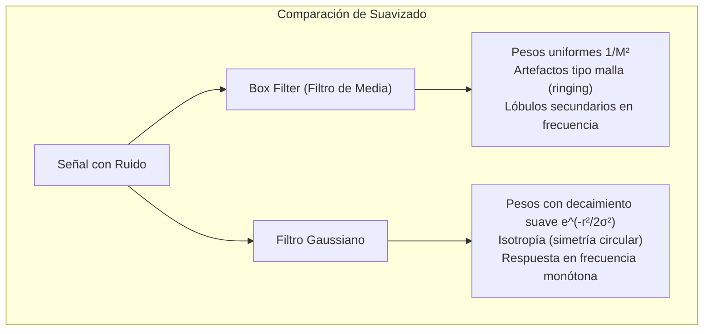
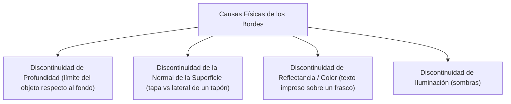
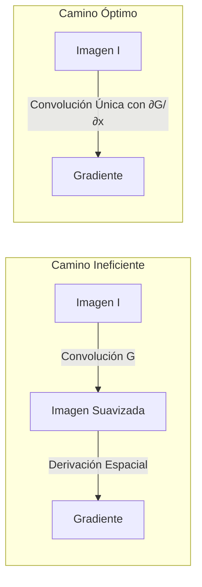
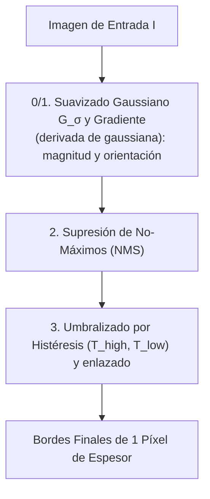
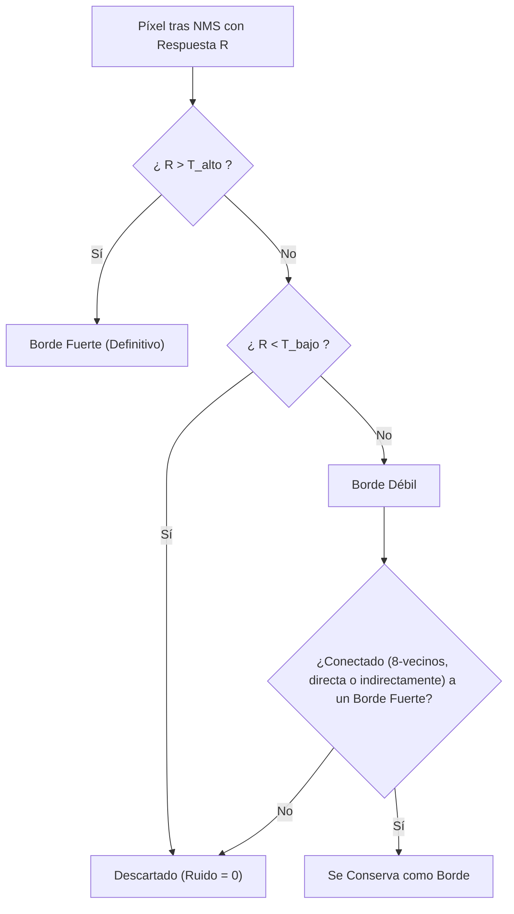

# 2. Filtros Gaussianos y Detección de Bordes

Este documento formaliza el núcleo analítico de la visión clásica para el análisis de bordes y escalas: la comparación entre filtros de media y gaussianos, la discretización del kernel gaussiano (regla $3\sigma$, relación $\sigma \leftrightarrow T$, aproximación binomial), las propiedades de la gaussiana (separabilidad y su coste, cierre bajo convolución), la física y matemáticas de los bordes, las derivadas discretas y el gradiente (con ejemplo numérico), los operadores de primer orden (Prewitt, Sobel, Scharr y cómo construir kernels mayores), la derivada de la gaussiana y su separabilidad, los operadores de segundo orden (Laplaciana, LoG, normalización de escala y DoG), y el algoritmo de detección de bordes de Canny con sus parámetros.

> [!info] Correspondencia con el material de clase
> Este bloque corresponde a las transparencias **T2.2 (Gaussian Filtering and Edges)**.

---

## 1. Suavizado: Box Filter frente a Filtro Gaussiano

El suavizado espacial es un proceso paso-baja (*low-pass*) que atenúa las altas frecuencias asociadas al ruido.



### Problemas del Box Filter (Filtro de Media)
Un *box filter* asigna el mismo peso a todas las posiciones del vecindario (y se normaliza por su suma, p. ej. $1/9$ en $3\times3$). Visto desde arriba es un cuadrado blanco sobre fondo negro. Al aplicarlo, la imagen se emborrona pero aparecen **artefactos o estructuras espurias, como una especie de malla sutil**:
1. **Falta de Isotropía:** El soporte cuadrado pesa igual a los píxeles lejanos de las esquinas que a los cercanos de los ejes.
2. **Oscilaciones espurias (*ringing*):** La transformada de Fourier de un pulso cuadrado es una función $\text{sinc}$, con lóbulos laterales alternantes que dejan pasar componentes de alta frecuencia. La gaussiana es un **mejor filtro paso-baja**: su respuesta en frecuencia es también gaussiana y no crea artefactos de alta frecuencia. (Detalle en [[3. Analisis de Frecuencia]].)

---

## 2. El Filtro Gaussiano Bidimensional

### Formulación Continua
$$ G_{\sigma}(x, y) = \frac{1}{2\pi\sigma^2} e^{-\frac{x^2 + y^2}{2\sigma^2}} $$

> [!info] Leyenda Matemática
> - $\sigma$: Desviación estándar. Controla la **escala / anchura / dispersión** de la campana y, por tanto, la cantidad de suavizado: con $\sigma = 1$ apenas hay diferencias; con $\sigma = 30$ la imagen queda fuertemente emborronada.
> - $x, y$: Coordenadas respecto al centro del kernel.
> - $\frac{1}{2\pi\sigma^2}$: Constante de normalización continua ($\iint G_\sigma = 1$).

Es un filtro **isotrópico** (circularmente simétrico): da más peso al píxel central y menos a los vecinos cuanto más lejos están.

```text
               Campana Gaussiana 2D (Perfil de sección)
                           │       ▲ G(x)
                           │      ╱ ╲
                           │     ╱   ╲
                       ────┼────╱─────╲────
                          -3σ  -σ  0   σ   3σ
```

```python
sigma = 0                                    # si no es positivo, OpenCV lo calcula a partir de ksize
for ksize in np.arange(3, 9, 2):             # 3, 5, 7
    kernel = cv2.getGaussianKernel(ksize, sigma)      # vector columna 1D
    outim = cv2.filter2D(im, -1, kernel @ kernel.T)   # kernel 2D = producto exterior
```

---

## 3. Discretización y Soporte Finito del Kernel

La gaussiana continua tiene soporte infinito: hay que **truncarla y muestrearla** en una matriz discreta. No existe una única forma de hacerlo (véase Birchfield, cap. 5.2.4, o `cv2.getGaussianKernel`); aquí seguimos la de clase.

### Los dos parámetros: tamaño y $\sigma$
Ambos están relacionados y deben ser coherentes:
- $\sigma = 5$ con kernel $11\times11$: soporte **demasiado pequeño** para una gaussiana tan ancha; se truncan las colas y la discretización es incompleta.
- $\sigma = 2$ con kernel $31\times31$: soporte **innecesariamente grande**; muchos coeficientes prácticamente nulos que cuestan multiplicaciones sin aportar nada.
- $\sigma = 5$ con kernel $31\times31$: combinación razonable.

### Regla del Soporte Espacial ($3\sigma$)
Según la distribución normal:
- En $[-1\sigma, +1\sigma]$ reside el $68.27\%$ de la masa.
- En $[-2\sigma, +2\sigma]$ reside el $95.45\%$.
- En $[-3\sigma, +3\sigma]$ reside el **$99.73\%$**.

Elegimos el menor entero $k \ge 3\sigma$ como semiancho; el tamaño total es $T = 2k + 1$:

$$ T = 2 \cdot \lceil 3\sigma \rceil + 1 \qquad \Longleftrightarrow \qquad k = \frac{T-1}{2} = 3\sigma \implies \sigma = \frac{T - 1}{6} $$

> [!info] Leyenda Matemática
> - $T$: Tamaño (número de coeficientes) de la máscara 1D.
> - $k$: Semiancho (radio) entero.
> - La relación $\sigma = (T-1)/6$ **no es universal**: es consecuencia de nuestra decisión de truncar en $\pm 3\sigma$.

> [!example] De $\sigma$ a $T$ y de $T$ a $\sigma$
> - $\sigma = 1.0 \implies k = 3 \implies T = 7$ (kernel $7\times7$).
> - $\sigma = 1.5 \implies k = \lceil 4.5 \rceil = 5 \implies T = 11$.
> - $T = 5 \implies k = 2 \implies \sigma = 2/3 \approx 0.67$. La máscara se obtiene evaluando $f(x) = e^{-x^2/(2\cdot 0.67^2)}$ en $x \in \{-2, -1, 0, 1, 2\}$.

### Procedimiento de clase
1. Partir de $f(x, \sigma) = c \cdot e^{-x^2/2\sigma^2}$ **ignorando la constante** $c = \frac{1}{\sigma\sqrt{2\pi}}$: no cambia la forma relativa del filtro y después normalizaremos.
2. Evaluar en las posiciones enteras $f(-k), \dots, f(-1), f(0), f(1), \dots, f(k)$.
3. **Normalizar** dividiendo cada coeficiente por la suma de todos:
   $$ \hat{H}[u] = \frac{H[u]}{\sum_{i=-k}^k H[i]} \qquad \text{de modo que } \sum_i \hat{H}[i] = 1 $$

> [!warning] ¿Por qué debe sumar 1?
> Un filtro de suavizado debe preservar el nivel medio de intensidad (**ganancia DC unitaria**). Si los coeficientes sumaran más de $1$, la imagen se aclararía hasta saturar; si menos, se oscurecería. El mismo procedimiento sirve para discretizar las **derivadas** de la gaussiana, con matices de normalización que veremos en la §9.

### Aproximación binomial (Pascal)
Otra forma sencilla de aproximar una gaussiana: **convolucionar un filtro caja consigo mismo repetidamente**. Partiendo de $[1, 1]/2$ se obtienen las filas del triángulo de Pascal, normalizadas:
$$ [1,1] * [1,1] = [1, 2, 1] \qquad [1,2,1] * [1,2,1] = [1, 4, 6, 4, 1] \qquad \dots $$
La fila $(2k+1)$-ésima aproxima una gaussiana con $\sigma^2 = k/2$: $k=1 \Rightarrow \sigma \approx 0.7$; $k=2 \Rightarrow \sigma = 1$. El binomial $[1,4,6,4,1]/16$ es el kernel de la pirámide gaussiana ([[4. Piramides y Escala]]).

---

## 4. Propiedades Teóricas Fundamentales

Resumen de propiedades de la gaussiana que explican su uso generalizado:
- Atenúa las altas frecuencias (**paso-baja**); todos los coeficientes son positivos y suman $1$.
- Queda **completamente descrita** por sus momentos de primer (media) y segundo orden (varianza).
- Su **transformada de Fourier es otra gaussiana**: $\mathcal{F}\{e^{-x^2/2\sigma^2}\} = \sqrt{2\pi}\sigma\, e^{-2\pi^2\sigma^2\omega^2}$.
- Es **cerrada bajo convolución** (semigrupo).
- Es **separable**.

### A. Separabilidad ($2D \longrightarrow 1D$)
La exponencial permite factorizar las variables:

$$ G_{\sigma}(x, y) = \frac{1}{2\pi\sigma^2} e^{-\frac{x^2 + y^2}{2\sigma^2}} = \left( \frac{1}{\sqrt{2\pi}\sigma} e^{-\frac{x^2}{2\sigma^2}} \right) \cdot \left( \frac{1}{\sqrt{2\pi}\sigma} e^{-\frac{y^2}{2\sigma^2}} \right) = G_{\sigma}(x) \cdot G_{\sigma}(y) $$

Matricialmente, el kernel 2D es el **producto exterior** de dos vectores 1D (`np.outer`, o `kernel @ kernel.T`):
$$ H_{2D} = \mathbf{g}_{1D} \cdot \mathbf{g}_{1D}^T \qquad \text{p. ej. } \begin{bmatrix} 1 \\ 2 \\ 1 \end{bmatrix} \begin{bmatrix} 1 & 2 & 1 \end{bmatrix} = \begin{bmatrix} 1 & 2 & 1 \\ 2 & 4 & 2 \\ 1 & 2 & 1 \end{bmatrix} $$

Gracias a la **asociatividad** de la convolución, $I * (v * h) = (I * v) * h$: una convolución 2D con kernel separable se sustituye por **dos convoluciones 1D consecutivas** (primero filas con el kernel X, que combina información de distintas columnas; luego columnas con el kernel Y, que combina distintas filas; o al revés). El resultado es **exactamente el mismo** que con el kernel 2D.

#### Ventaja de Complejidad Computacional
Para una imagen $n \times n$ y un kernel $m \times m$:
- **No separable:** $m^2$ multiplicaciones por píxel $\implies \mathcal{O}(n^2 m^2)$.
- **Separable:** dos pasadas de $m$ multiplicaciones $\implies 2 m n^2 \implies \mathcal{O}(n^2 m)$.

$$ \text{Aceleración} = \frac{m^2}{2m} = \frac{m}{2} $$

> [!example] Impacto Práctico
> Imagen $512\times512$, filtro $11\times11$: directa $512 \cdot 512 \cdot 121 \approx 31.7$M multiplicaciones; separable $2 \cdot 512 \cdot 512 \cdot 11 \approx 5.8$M (factor $\approx 5.5$). Para un kernel de $15 \times 15$: $225$ frente a $30$ operaciones/píxel (reducción del **$86.7\%$**).

> [!warning] La ventaja aparece al filtrar toda la imagen
> Si contamos sólo las operaciones para **un único píxel** de salida (ejemplo de Grauman: $3\times3$, resultado $11 + 36 + 18 = 65$), la versión directa usa $9$ multiplicaciones y la separable $12$: no hay ventaja. El ahorro surge porque los resultados intermedios de la primera pasada 1D **se reutilizan** para muchos píxeles de salida.

#### ¿Qué kernels son separables?
Un kernel 2D es separable **si y sólo si tiene rango 1**: todas sus filas (y columnas) no nulas son múltiplos entre sí. Ejemplos separables: gaussiana, box. Contraejemplo: el Laplaciano
$$ \begin{bmatrix} 0 & 1 & 0 \\ 1 & -4 & 1 \\ 0 & 1 & 0 \end{bmatrix} $$
no lo es, porque $[0,1,0]$ y $[1,-4,1]$ son linealmente independientes ($\alpha[0,1,0] + \beta[1,-4,1] = 0 \Rightarrow \alpha = \beta = 0$).

> [!tip] SVD y aproximaciones de bajo rango
> Cualquier kernel 2D admite una descomposición SVD como **suma de componentes de rango 1**, cada una separable. Conservando todas, la representación es exacta; conservando sólo las de mayores valores singulares, se obtiene una aproximación de bajo rango más barata.

---

### B. Propiedad de Semigrupo (Cierre bajo Convolución)
La convolución de dos gaussianas es **otra gaussiana** cuya varianza es la suma de las varianzas:

$$ G_{\sigma_1} * G_{\sigma_2} = G_{\sigma_{eq}}, \quad \sigma_{eq} = \sqrt{\sigma_1^2 + \sigma_2^2} $$

#### Aplicación de $n$ Convoluciones Idénticas
$$ \sigma_{eq} = \sqrt{n} \, \sigma \qquad (\text{dos pasadas: } \sigma\sqrt{2}) $$
En el caso continuo ideal es exacto; con kernels discretos truncados, aproximado.

#### Crecimiento del Soporte Espacial
Al convolucionar $k$ filtros idénticos de tamaño $N$ (convolución *full*), el soporte crece:

$$ N_{eq} = N + (k - 1)(N - 1) $$

> [!example] Ejemplo de Examen (Homework T2.2)
> Kernel gaussiano $9 \times 9$ aplicado 3 veces: $\sigma = (9-1)/6 \approx 1.33$; $\sigma_{eq} = \sqrt{3}\,\sigma \approx 2.31$; soporte exacto equivalente $N_{eq} = 9 + 2 \times 8 = 25$; soporte "con el mismo desenfoque" $T = 2\lceil 3 \cdot 2.31 \rceil + 1 = 15$. Resolución completa en [[5. Ejercicios y Preguntas de Examen]].

---

## 5. Detección de Bordes y Altas Frecuencias

Un **borde** (*edge*) es un cambio abrupto de intensidad; en el "paisaje" de la imagen aparece como un **acantilado** (pendiente muy pronunciada). Un **contorno** es una curva cerrada que une puntos de borde para representar la forma de un objeto. En términos de frecuencia: si el cambio "involucra" muchos píxeles es **baja frecuencia**; si pocos (abrupto), **alta frecuencia**.

### ¿Por qué detectar bordes?
Convierte una imagen 2D en un conjunto de curvas: extrae las estructuras salientes de la escena en una representación mucho **más compacta** que los píxeles. Los *sketches* de líneas (Walther et al., PNAS 2011) muestran que **gran parte de la información se conserva en los bordes**: aun sin color ni textura reconocemos una playa, una calle, un bosque, una oficina.

### Origen físico de los bordes

Un borde es sólo una discontinuidad de intensidad; su causa física puede ser muy distinta.

### Recordatorio: la derivada
La derivada de una función en un punto es la pendiente de la tangente: mide la sensibilidad local de la salida ante pequeños cambios de la entrada. Sobre una gaussiana: lejos del centro es $\approx 0$; al crecer la campana es positiva (máxima en el punto de inflexión); en el máximo vale $0$; después negativa; y vuelve a $0$. **Los bordes corresponden a extremos de la primera derivada**: su signo indica la dirección del cambio (blanco→negro negativa; negro→blanco positiva) y su magnitud lo brusco que es.

### Derivadas Discretas (diferencias finitas)
Para una función continua, $\frac{\partial f}{\partial x} = \lim_{\varepsilon \to 0} \frac{f(x+\varepsilon, y) - f(x, y)}{\varepsilon}$. Con píxeles aproximamos mediante **diferencias entre intensidades de píxeles adyacentes**, implementadas como filtros lineales:

| Aproximación | Fórmula | Kernel (como correlación) | Comentario |
| :--- | :---: | :---: | :--- |
| **Progresiva (*forward*)** | $I[x+1] - I[x]$ | $[\,\cdot\,, -1, 1]$ (tamaño par) | Sobre $[4, 7, 8, 1, 3]$ con replicación: $[3, 1, -7, 2, 0]$. |
| **Regresiva (*backward*)** | $I[x] - I[x-1]$ | $[-1, 1, \,\cdot\,]$ | Misma información, desplazada una posición: $[0, 3, 1, -7, 2]$. |
| **Central** | $\frac{I[x+1] - I[x-1]}{2}$ | $\frac{1}{2}[-1, 0, 1]$ | Simétrica, sin desplazamiento, precisión $\mathcal{O}(h^2)$ con $h = 2$. Sobre la misma señal (sin el $1/2$): $[3, 4, -6, -5, 2]$. |

> [!warning] Kernels de tamaño impar y la inversión de la convolución
> - Los kernels de tamaño par no tienen centro único y producen un **desplazamiento** de la señal; la diferencia central lo evita.
> - En convolución el kernel se rota: el kernel de la diferencia central escrito "para convolucionar" es $\frac{1}{2}[1, 0, -1]$. Como es antisimétrico, correlación y convolución difieren en el **signo**.
> - La diferencia central puede verse como $\frac{1}{2}[1, 1] * [1, -1]$: un pequeño **suavizado** seguido de una **diferencia**. El factor $1/2$ da la escala correcta de la derivada, pero para localizar bordes suele ignorarse: sólo queremos detectar diferencias.

---

## 6. El Vector Gradiente de la Imagen

$$ \nabla f = \begin{bmatrix} G_x \\ G_y \end{bmatrix} = \begin{bmatrix} \frac{\partial f}{\partial x} \\ \frac{\partial f}{\partial y} \end{bmatrix} $$

1. **Magnitud del Gradiente (fuerza del borde):**
   $$ \|\nabla f\| = \sqrt{G_x^2 + G_y^2} \quad (\text{siempre } \ge 0) $$
   En implementaciones rápidas se aproxima por $|G_x| + |G_y|$.
2. **Dirección / Orientación:**
   $$ \theta = \operatorname{atan2}(G_y, G_x) $$

> [!important] Geometría Fundamental del Gradiente
> - $\nabla f$ apunta en la **dirección de máximo crecimiento de la intensidad**.
> - Es **perpendicular (ortogonal)** al borde; la tangente al borde es $\theta \pm 90^\circ$.

> [!example] Cálculo detallado (L. Sigal; T2.2, slides 38–42)
> Sobre una imagen $9\times9$ con el kernel $[-1, 1]$ en $x$ (asociando el resultado al píxel izquierdo) y su versión columna en $y$, sin padding: la derivada en $x$ queda de $9\times8$ y la de $y$ de $8\times9$ (la última columna/fila no se calcula). En un píxel con $G_x = 70$, $G_y = 64$:
> $$ \|\nabla f\| = \sqrt{70^2 + 64^2} \approx 94.85, \qquad \theta = \tan^{-1}(64/70) \approx 42^\circ $$
> En el píxel inferior, $G_x = 64$, $G_y = -64$: $\theta = \tan^{-1}(-1) = -45^\circ$.

> [!warning] `atan2` frente a `atan`
> La arcotangente del cociente $G_y/G_x$ pierde los signos individuales y devuelve ángulos en un rango de $180^\circ$: **no distingue vectores opuestos**. `atan2(Gy, Gx)` considera ambos signos y devuelve la dirección en los $360^\circ$ completos.

> [!tip] Visualizar derivadas
> Las derivadas tienen valores **negativos**. Para mostrarlas hay que "transferir" los valores a $[0,255]$ o $[0,1]$ (p. ej. negro = más negativo, gris = cero, blanco = más positivo); de ahí que las regiones constantes aparezcan grises. Y hay que procesar en **coma flotante**: en `uint8` OpenCV satura los negativos a $0$ ([[1. Representacion y Filtrado]], §10).

---

## 7. Operadores de Gradiente de Primer Orden

Todos combinan **diferencia central en una dirección** con **suavizado en la perpendicular** (producto exterior). Los factores constantes ($1/6$, $1/8$) suelen omitirse: sólo escalan la respuesta y no cambian la localización de los bordes.

### A. Operador de Prewitt
$$ P_x = \frac{1}{6} \begin{bmatrix} -1 & 0 & 1 \\ -1 & 0 & 1 \\ -1 & 0 & 1 \end{bmatrix} = \frac{1}{3}\begin{bmatrix} 1 \\ 1 \\ 1 \end{bmatrix} \cdot \frac{1}{2}\begin{bmatrix} -1 & 0 & 1 \end{bmatrix} \qquad (\text{suavizado box} + \text{diferencia central}) $$

### B. Operador Sobel (1968)
Suavizado **binomial** $[1, 2, 1]$ en la dirección ortogonal:

$$ S_x = \frac{1}{8}\begin{bmatrix} -1 & 0 & 1 \\ -2 & 0 & 2 \\ -1 & 0 & 1 \end{bmatrix} = \frac{1}{4}\begin{bmatrix} 1 \\ 2 \\ 1 \end{bmatrix} \cdot \frac{1}{2}\begin{bmatrix} -1 & 0 & 1 \end{bmatrix} \qquad S_y = \frac{1}{8}\begin{bmatrix} -1 & -2 & -1 \\ 0 & 0 & 0 \\ 1 & 2 & 1 \end{bmatrix} $$

> [!warning] Trampa Conceptual Habitual de Examen
> - $S_x$ calcula la **derivada respecto a $X$** (variación horizontal): detecta **BORDES VERTICALES**.
> - $S_y$ calcula la **derivada respecto a $Y$**: detecta **BORDES HORIZONTALES**.

> [!example] Círculo sintético y cebras (T2.2, slides 36–37)
> Con $S_x$ sobre un círculo blanco sobre negro: respuesta $0$ en las zonas constantes, positiva en un lado del círculo y negativa en el otro. Con $S_y$, la parte superior positiva (blanca) y la inferior negativa (negra). Las imágenes de las diapositivas son **correlaciones** (kernel sin invertir); con convolución estricta los signos se intercambiarían. La magnitud $\sqrt{G_x^2 + G_y^2}$ combina ambas y no tiene signo; la orientación se obtiene con `atan2`.

> [!info] ¿Correlación o convolución con Sobel?
> Los kernels de Sobel son **antisimétricos**: rotarlos 180° equivale a cambiarles el signo. Por tanto, las derivadas cambian de signo, la **magnitud no cambia** y la **orientación cambia 180°**.

### C. Operador de Scharr
Optimiza los coeficientes para minimizar el error angular (mayor isotropía que Sobel):
$$ Scharr_x = \begin{bmatrix} -3 & 0 & 3 \\ -10 & 0 & 10 \\ -3 & 0 & 3 \end{bmatrix} = \begin{bmatrix} 3 \\ 10 \\ 3 \end{bmatrix} \cdot \begin{bmatrix} -1 & 0 & 1 \end{bmatrix} $$

### D. Construir kernels de derivada mayores
Se generan **recursivamente** con el kernel de diferencia central y el binomial (`sp.convolve(..., mode='full')`, `np.outer`, o `cv2.getDerivKernels`):

| Tamaño | Kernel 1D de derivación | Kernel 1D de suavizado |
| :---: | :---: | :---: |
| 3 | $[1, 0, -1]$ | $[1, 2, 1]$ |
| 5 | $[1,2,1] * [1,0,-1] = [1, 2, 0, -2, -1]$ | $[1,2,1] * [1,2,1] = [1, 4, 6, 4, 1]$ |
| 7 | $[1,4,6,4,1] * [1,0,-1] = [1, 4, 5, 0, -5, -4, -1]$ | $[1,4,6,4,1] * [1,2,1] = [1, 6, 15, 20, 15, 6, 1]$ |

El kernel Sobel 2D de $5\times5$ (o $7\times7$) es el **producto exterior** del vector de derivación en una dirección y el de suavizado en la perpendicular. Por ejemplo, $S_y^{5\times5}$ tiene filas $[-1,-4,-6,-4,-1]$, $[-2,-8,-12,-8,-2]$, $[0,0,0,0,0]$, $[2,8,12,8,2]$, $[1,4,6,4,1]$.

---

## 8. Ruido y Derivadas: Asociatividad y Derivada de la Gaussiana

La diferenciación amplifica el ruido (componentes de alta frecuencia): en un perfil ruidoso con un escalón, la derivada directa es tan ruidosa que no se distingue el borde. **Solución: suavizar primero** con $h$ y luego derivar: $\frac{d}{dx}(f * h)$ muestra un pico limpio en el borde. Eso son dos convoluciones.

Como la derivación es una convolución y la convolución es asociativa (y conmuta con la derivada):

$$ \frac{\partial}{\partial x} (I * G_\sigma) = I * \left( \frac{\partial}{\partial x} G_\sigma \right) $$



**Nos ahorramos una operación:** precalculamos la **Derivada de la Gaussiana**:
$$ \frac{\partial G_\sigma}{\partial x} = -\frac{x}{\sigma^2} \, G_\sigma(x, y) = -\frac{x}{2\pi\sigma^4} \, e^{-\frac{x^2+y^2}{2\sigma^2}} $$

En 2D tiene una región positiva a un lado, negativa al otro y un cruce por cero en el centro, extendida a lo largo de la otra dimensión. Existen versiones en $x$ y en $y$; el signo global no es importante para detectar bordes.

### La derivada de la gaussiana también es separable
Como $G(x,y) = G(x)G(y)$ y $G(y)$ no depende de $x$:
$$ \frac{\partial G}{\partial x}(x, y) = G'(x)\,G(y) $$

> [!important] Derivar en una dirección, suavizar en la otra
> La derivada parcial de la gaussiana se compone de la **derivada 1D** en una dirección y la **gaussiana 1D** (suavizado) en la perpendicular. Tres razones para quedarse con esto:
> 1. Es matemáticamente exacto (la derivada de un kernel separable es separable).
> 2. Es lo que queremos en la práctica: al derivar, **suavizar implícitamente** en la dirección perpendicular para no amplificar el ruido.
> 3. Un kernel separable permite dos convoluciones 1D (coste $\mathcal{O}(n^2 m)$). Es la misma filosofía de Sobel: diferencia en $x$ y binomial $[1,2,1]$ en $y$.

---

## 9. Operadores de Segundo Orden: Laplaciana, LoG y DoG

Hay tres segundas derivadas distintas ($f_{xx}$, $f_{yy}$ y la mixta $f_{xy} = f_{yx}$ bajo condiciones de suavidad; la diapositiva habla de cuatro contando $f_{xy}$ y $f_{yx}$). En visión es cómodo combinar las dos puras en un único filtro **isotrópico** (no privilegia direcciones): el Laplaciano.

### Operador Laplaciano ($\nabla^2 f$)
Es la **divergencia del gradiente**, igual a la suma de las segundas derivadas puras (la **traza de la matriz Hessiana**):

$$ \nabla^2 f = \frac{\partial^2 f}{\partial x^2} + \frac{\partial^2 f}{\partial y^2} $$

- Los bordes son **máximos locales** de la primera derivada y **cruces por cero** (*zero-crossings*) de la segunda: donde la primera derivada tiene un extremo, su derivada cambia de signo. Los cruces por cero dan un criterio simple de localización (algoritmo de Marr-Hildreth, 1980), pero hay que tener cuidado con el ruido.

```text
        Perfil de Borde Escalón y sus Derivadas:
        Intensidad f(x)           Primera Derivada f'(x)      Segunda Derivada f''(x)
              ┌──────                    ▲                           ▲
              │                         ╱ ╲                         ╱ ╲
              │                        ╱   ╲                       ╱   ╲
        ──────┘                  ─────┼─────┼─────           ─────┼─────•─────┼─────
                                      │                            │   Cruce │
                                      │ PICO                           por cero
```

Kernel discreto $3\times3$ (el "sombrero mexicano invertido"):
$$ \nabla^2 \approx \begin{bmatrix} 0 & 1 & 0 \\ 1 & -4 & 1 \\ 0 & 1 & 0 \end{bmatrix} $$
Sus coeficientes **suman cero** (como todo kernel de derivada: derivar una constante da $0$). Según la convención de signo puede aparecer multiplicado por $-1$; la magnitud de la respuesta es la misma. **No es separable** (rango $> 1$).

### Laplaciana de la Gaussiana (LoG)
Para no amplificar el ruido se aplica el Laplaciano sobre la imagen suavizada. Moviendo las derivadas al kernel (asociatividad) y agrupando por distributividad:

$$ \nabla^2 (I * G) = I * G_{xx} + I * G_{yy} = I * (G_{xx} + G_{yy}) = I * \nabla^2 G $$

$$ \nabla^2 G_{\sigma}(x, y) = \frac{x^2 + y^2 - 2\sigma^2}{2\pi\sigma^6} \, e^{-\frac{x^2+y^2}{2\sigma^2}} $$

#### Cómo calcularla: suma de dos términos separables
El Laplaciano discreto no es separable, pero la LoG **sí es suma de dos kernels separables**, porque la gaussiana y sus derivadas lo son:
$$ \nabla^2 G = G''(x)\,G(y) + G(x)\,G''(y) $$
- Término 1: convolución 1D con $G''(x)$ en horizontal y con $G(y)$ en vertical.
- Término 2: convolución con $G(x)$ en horizontal y con $G''(y)$ en vertical.
- Sumar ambas respuestas: **4 convoluciones 1D** en total.

> [!example] ¿Compensa?
> - Kernel $7\times7$: directa $49$ multiplicaciones/píxel; separable $4 \times 7 = 28$ (y $\approx 25$ sumas). **Sí**, y la ventaja crece con el tamaño.
> - Kernel $3\times3$: directa $9$; separable $12$. **No.**

### Normalización de escala: ¿por qué multiplicar por $\sigma^2$?
$$ L = \sigma^2 \left( G_{xx}(x,y,\sigma) + G_{yy}(x,y,\sigma) \right) $$

En los kernels de suavizado normalizamos para que sumen $1$. En los de derivada la situación es distinta: al aumentar $\sigma$, **los picos (en valor absoluto) de las derivadas de la gaussiana disminuyen**, y la respuesta a un mismo escalón ideal decrece con $\sigma$. Intuición: un cordón sobre la mesa con la forma del sombrero mexicano; al separar los extremos (aumentar $\sigma$) la función se ensancha y sus lóbulos pierden amplitud.

> [!important] Regla de normalización de escala
> Para que las respuestas a distintas escalas sean **comparables** (*scale-invariant*), una derivada de orden $n$ se multiplica por $\sigma^n$: la primera derivada por $\sigma$, el Laplaciano (segunda) por $\sigma^2$. Con normalización, el pico de respuesta se mantiene constante ($\approx 1$); sin ella decae hasta casi $0$ para $\sigma \approx 10$. Es esencial para **seleccionar la escala** en la que una estructura produce respuesta máxima (base de los detectores de *blobs* y de SIFT, Tema 3).

### Aproximación por Diferencia de Gaussianas (DoG)
Podemos aproximar la LoG **sin implementar ninguna segunda derivada**: basta suavizar la imagen con dos gaussianas de escalas $\sigma$ y $k\sigma$ y **restar** las dos imágenes suavizadas:

$$ DoG = G(x, y, k\sigma) - G(x, y, \sigma) \approx (k - 1)\, L = (k-1)\,\sigma^2 \nabla^2 G $$

> [!info] Leyenda Matemática
> - $k > 1$: Razón entre las dos escalas. Marr y Hildreth (1980) recomiendan $k \approx 1.6$ para el mejor ajuste a la LoG.
> - $(k-1)$: Factor de escala entre DoG y LoG normalizada; ambas funciones tienen una forma muy similar.
> - La DoG es un filtro **paso-banda** ([[3. Analisis de Frecuencia]]) y es la base de la **pirámide laplaciana** ([[4. Piramides y Escala]]).

### Efecto de $\sigma$ sobre las estructuras detectadas
Con derivadas gaussianas de $\sigma = 1$ aparecen muchas estructuras finas (pelo del panda, textura del fondo); con $\sigma = 3$ desaparecen y la respuesta se concentra en bordes gruesos y el contorno general. **$\sigma$ es un parámetro de escala**: valores pequeños para detalles finos, grandes para estructuras mayores. No existe un único $\sigma$ correcto.

> [!tip] Resumen: dos familias de kernels (S. Birchfield)
> | Familia | Suma de coeficientes | Ejemplo | Comportamiento |
> | :--- | :---: | :---: | :--- |
> | **Suavizado** (suavizar una constante no debe cambiarla) | $1$ | $\frac{1}{4}[1, 2, 1]$ | Paso-baja (gaussiana): *blur* para eliminar ruido. |
> | **Derivación** (derivar una constante debe dar $0$) | $0$ | $[-1, 0, 1]$ | Paso-alta (derivada de gaussiana): resalta detalles. |
>
> Visualmente los resultados son opuestos, pero **la matemática subyacente es la misma**: convoluciones con distintos kernels.

---

## 10. El Detector de Bordes de Canny (1986)

La magnitud del gradiente (p. ej. Sobel) produce **bandas anchas** de respuesta alrededor de cada transición, y muchas respuestas por textura: ¿dónde está exactamente el borde? Canny (*A Computational Approach to Edge Detection*, PAMI 1986, ~50K citas) transforma esa respuesta gruesa en una localización precisa. Sigue siendo popular por ser fácil de implementar, con pocos parámetros intuitivos, eficiente y con buenos resultados. **No es "otro kernel", sino un procedimiento de varias etapas.**

Formuló la detección como un problema de optimización con **tres criterios**:
1. **Baja Tasa de Error:** no omitir bordes verdaderos ni marcar bordes falsos.
2. **Buena Localización:** minimizar la distancia entre el píxel marcado y el borde real.
3. **Respuesta Única:** un solo píxel de respuesta por borde (sin bordes anchos ni duplicados).



### Etapa 0/1: Suavizado y Gradiente
Se filtra la imagen con una **derivada de gaussiana** (equivalente a suavizar y aplicar Sobel) y se calcula en cada píxel la magnitud y la orientación `theta = atan2(gy, gx)` (que en la visualización de clase se codifica por color, de $0$ a $360^\circ$). El suavizado previo reduce las respuestas espurias por ruido. El parámetro $\sigma$ controla la escala:
- $\sigma$ pequeño: bordes finos y detalles menores.
- $\sigma$ grande: bordes a gran escala de estructuras dominantes.

### Etapa 2: Supresión de No-Máximos (*Non-Maximum Suppression*, NMS)
Para cada píxel, lo conservamos **sólo si tiene la mayor magnitud de gradiente a lo largo de la dirección del gradiente** en su vecindario local; en caso contrario se suprime (se pone a $0$). Así las bandas anchas se adelgazan a **1 píxel**.

- El punto $A$ está en el borde; la dirección del gradiente es normal al borde; $B$ y $C$ son los vecinos en esa dirección. Si $M(A) > M(B)$ y $M(A) > M(C)$, $A$ pasa a la siguiente etapa; si no, se elimina.
- En una rejilla no hay vecinos exactamente alineados con una dirección arbitraria ($17^\circ$, $63^\circ$...), así que la dirección se **cuantiza** a $0^\circ$, $45^\circ$, $90^\circ$ o $135^\circ$:
  - **Horizontal ($0^\circ$):** $[-22.5^\circ, 22.5^\circ] \cup [157.5^\circ, 180^\circ] \cup [-180^\circ, -157.5^\circ]$ → se comparan los vecinos izquierdo y derecho.
  - **Diagonal $45^\circ$:** $[22.5^\circ, 67.5^\circ] \cup [-157.5^\circ, -112.5^\circ]$.
  - **Vertical ($90^\circ$):** $[67.5^\circ, 112.5^\circ] \cup [-112.5^\circ, -67.5^\circ]$.
  - **Diagonal $135^\circ$:** $[112.5^\circ, 157.5^\circ] \cup [-67.5^\circ, -22.5^\circ]$.

```text
              Cuantización de Direcciones en NMS (Vecindad 3x3)
                           [90°]
                       \     │     /
                 [135°] \    │    /  [45°]
                         \   │   /
              ─────────────(x, y)───────────── [0°]
                         /   │   \
                 [45°]  /    │    \  [135°]
                       /     │     \
                           [90°]
```

### Etapa 3: Umbralizado por Histéresis y Enlazado
Tras la NMS quedan bordes finos pero muchas respuestas débiles, unas reales y otras por ruido. Un umbral único provocaría bordes discontinuos (*streaking*). Canny usa **dos umbrales** ($T_{alto}$ y $T_{bajo}$) y tres casos para la respuesta $R$:



1. **$R > T_{alto}$:** borde fuerte; se acepta.
2. **$R < T_{bajo}$:** no es borde; se elimina.
3. **$T_{bajo} \le R \le T_{alto}$:** borde débil; se conserva **si y sólo si** conecta (en un vecindario, habitualmente los 8 más cercanos) con un borde fuerte, directamente o a través de una cadena de débiles.

> [!important] Intuición de la histéresis
> *El umbral alto inicia las curvas de borde; el umbral bajo las continúa.* No se decide píxel a píxel con un único umbral, sino usando la **conectividad espacial**: recuperamos fragmentos débiles de bordes reales y eliminamos respuestas débiles aisladas. Sólo con $T_{alto}$ el resultado es limpio pero **fragmentado**; sólo con $T_{bajo}$ aparece **mucho ruido**; la histéresis combina la fiabilidad del alto con la continuidad del bajo. Ratios típicas $T_{alto}/T_{bajo}$ de $2{:}1$ o $3{:}1$.

### Parámetros a ajustar
| Parámetro | Efecto |
| :--- | :--- |
| $\sigma_d$ (anchura de la derivada de gaussiana) / $\sigma_s$ (suavizado) | **Escala**: $\sigma = 1$ detecta muchos contornos y detalles locales; $\sigma = 2$ elimina los finos y conserva estructuras grandes y persistentes. |
| $T_{alto}$ | Qué respuestas se consideran bordes fuertes. |
| $T_{bajo}$ | Hasta dónde se siguen los bordes a través de zonas débiles. |

Los parámetros no sólo controlan *cuántos* bordes se detectan, sino la **escala espacial** de las estructuras consideradas relevantes. (OpenCV: `cv2.Canny`.)

---

## 11. Conexión Conceptual con el Temario

- **Fundamentos previos:** En [[1. Representacion y Filtrado]], se explicaron la convolución, las condiciones de contorno, el *unsharp masking* y el umbralizado de Otsu.
- **Perspectiva Espectral:** En [[3. Analisis de Frecuencia]], analizaremos por qué la gaussiana es un paso-baja sin lóbulos laterales, por qué LoG y DoG son paso-banda, y la transformada de la gaussiana.
- **Espacio de Escala:** En [[4. Piramides y Escala]], el suavizado gaussiano con el binomial $[1,4,6,4,1]$ y la DoG se convierten en las pirámides gaussiana y laplaciana.
- **Exámenes y Quizzes:** En [[5. Ejercicios y Preguntas de Examen]], dispones de las preguntas oficiales resueltas sobre $\sigma_{eq}$, el soporte en cascada, separabilidad y coste, el cálculo del gradiente, Sobel con correlación/convolución y la naturaleza no lineal de Canny.

---

### 📚 Referencias Bibliográficas

- **Szeliski, Richard** (2022). *Computer Vision: Algorithms and Applications* (2nd ed.). Springer.
  - **Capítulo / Sección:** Chapter 3: Image processing $\to$ Section 3.2.2: *Linear filtering examples* y Chapter 7: Feature detection $\to$ Section 7.2: *Edges and contours*.
  - **Archivo local:** [[docs_clase/textBook/Szeliski/Chapter_3_Image_processing/3.2_Linear_filtering.md|Szeliski - Chapter 3.2 Linear filtering]] y [[docs_clase/textBook/Szeliski/Chapter_7_Feature_detection_and_matching/7.2_Edges_and_contours.md|Chapter 7.2 Edges and contours]].
  - **Capítulo / Sección:** Chapter 3: Image processing $\to$ Section 3.5.3: *Multi-resolution representations* (LoG como segunda derivada de la gaussiana y DoG, Fig. 3.34). Páginas 139–154 del PDF.
  - **Archivo local:** [[docs_clase/textBook/Szeliski/Chapter_3_Image_processing/3.5_Pyramids_and_wavelets.md|Szeliski - Chapter 3.5 Pyramids and wavelets]].
- **Forsyth, David A.; Ponce, Jean** (2012). *Computer Vision: A Modern Approach* (2nd ed.). Pearson.
  - **Capítulo / Sección:** Chapter 4: Linear Filters $\to$ Section 4.1: *Linear Filters and Convolution* y Chapter 5: Local Image Features $\to$ Section 5.1: *Computing the Image Gradient* y 5.2: *Representing the Image Gradient*.
  - **Archivo local:** [[docs_clase/textBook/Forsyth_Ponce/4_Linear_Filters/4.1_Linear_Filters_and_Convolution.md|Forsyth & Ponce - Chapter 4.1 Linear Filters and Convolution]] y [[docs_clase/textBook/Forsyth_Ponce/5_Local_Image_Features/5.1_Computing_the_Image_Gradient.md|Chapter 5.1 Computing the Image Gradient]].
- **Torralba, Antonio; Isola, Phillip; Freeman, William T.** (2024). *Foundations of Computer Vision*. MIT Press.
  - **Capítulo / Sección:** Blur Filters $\to$ *Gaussian Filters and Separability*.
  - **Archivo local:** [[docs_clase/textBook/Torralba_Foundations/blurring_2.md|Torralba - Blur Filters]].
- **Material Oficial Docente UGR** (2026). *Transparencias y Anotaciones de Clase de Visión por Computador: T2.2 Gaussian Filtering and Edges*. Pablo Mesejo, Departamento de Ciencias de la Computación e Inteligencia Artificial, Universidad de Granada.
  - **Archivo local:** [[docs_clase/T2/2.2.GaussianFilters_Edges_comentada.pdf|Transparencias T2.2 (comentadas)]].
- **Canny, John** (1986). *A Computational Approach to Edge Detection*. IEEE Transactions on Pattern Analysis and Machine Intelligence (PAMI), 8(6), 679-698.
- **Marr, David; Hildreth, Ellen** (1980). *Theory of edge detection*. Proceedings of the Royal Society of London B, 207, 187-217.
