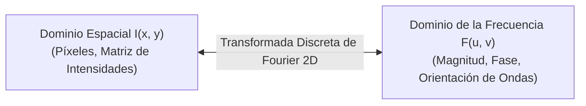
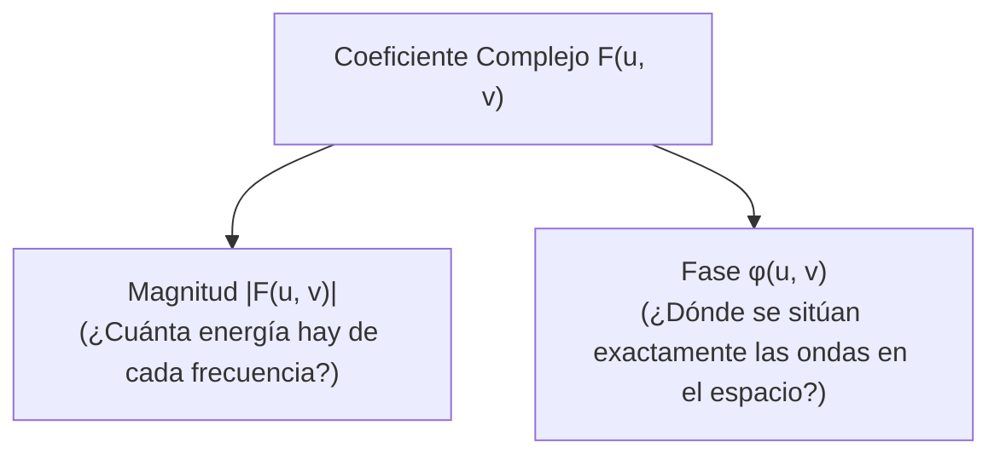
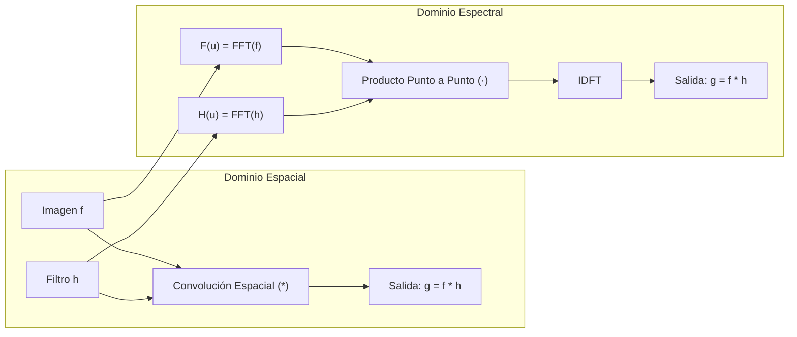
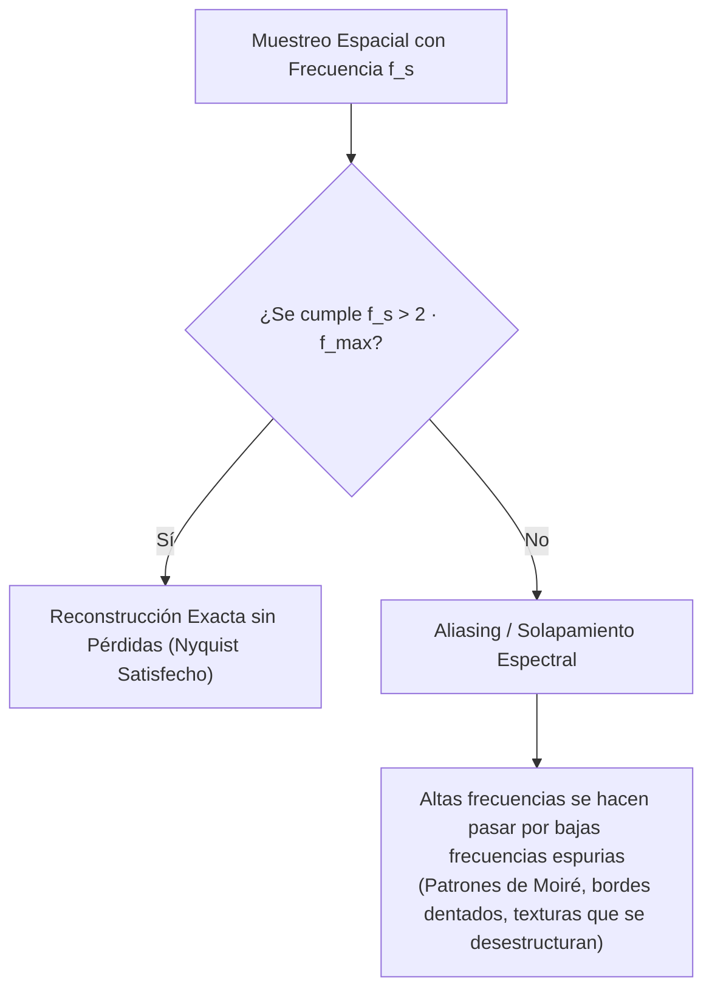

# 3. Análisis de Frecuencia en Imágenes

Este documento explora el dominio transformado de Fourier en dos dimensiones: la idea de Fourier de descomponer cualquier señal en sinusoides, las ecuaciones discretas (2D-DFT y 2D-IDFT), cómo leer una "imagen de Fourier" (componente DC, pares simétricos, distancia y orientación), el papel de la magnitud frente a la fase (experimentos de Oppenheim & Lim y de Kundur), el Teorema de la Convolución y su uso para implementar filtrado por FFT, la clasificación de filtros espectrales (paso-baja, paso-alta y paso-banda, incluyendo LoG/DoG), por qué el *box filter* produce artefactos y la gaussiana no, y el Teorema de Muestreo de Nyquist-Shannon junto con el fenómeno de *aliasing* y los filtros *anti-aliasing*.

> [!info] Correspondencia con el material de clase
> Este bloque corresponde a la sección *Thinking in Frequency* de las transparencias **T2.3 (Pyramids)**. El fichero `2.3.FourierAnalysis_in_Images.pptx` contiene únicamente los cuatro GIF animados de Derek Hoiem que ya aparecen en las diapositivas 48–51 de ese PDF (sinusoides 2D y su espectro), por lo que no aporta contenido adicional.

---

## 1. De la Intuición Espacial a la Frecuencia Espacial

### La idea de Fourier (1807)
Jean-Baptiste Joseph Fourier propuso que *cualquier* función periódica (bajo condiciones técnicas razonables) puede escribirse como una **suma ponderada de senos y cosenos de distintas frecuencias**. La idea fue recibida con escepticismo por Lagrange, Laplace y Poisson, y el trabajo no se tradujo al inglés hasta 1878. Hoy la conocemos como **serie de Fourier**, y su extensión a señales no periódicas es la **transformada de Fourier**.

El bloque básico de construcción es una sinusoide, determinada por tres parámetros:

$$ f(x) = A \sin(2\pi u x + \varphi) $$

> [!info] Leyenda Matemática
> - $A$: Amplitud (valor de pico de la onda en el dominio espacial).
> - $u$: Frecuencia ($u = 1/T$, siendo $T$ el periodo).
> - $\varphi$: Fase (desplazamiento de la onda respecto al origen).

Sumando suficientes sinusoides con las amplitudes, frecuencias y fases adecuadas se puede aproximar cualquier señal (por ejemplo, una onda cuadrada: con una componente la aproximación es pobre, pero mejora al añadir la segunda, tercera, cuarta... aunque aparecen oscilaciones características cerca de las discontinuidades).

> [!important] Sin pérdida de información
> La transformada de Fourier (FT) representa una señal $f(x)$ mediante las amplitudes y fases de sus sinusoides constituyentes. La transformada inversa (IFT) recupera $f(x)$ exactamente a partir de ellas. Pasar al dominio de Fourier **no implica perder información**: es la misma señal expresada en otra base.

### Cambio de base
Forsyth & Ponce presentan la transformada de Fourier como un **cambio de base**: hasta ahora pensábamos una imagen como suma ponderada de funciones "caja" (un píxel = una caja); ahora la expresamos como suma ponderada de sinusoides. El valor de la transformada en una frecuencia concreta es el **producto escalar** entre la imagen y esa sinusoide, es decir, mide *cuánto de esa sinusoide hay en la imagen*. Los cambios rápidos de la imagen se hacen evidentes porque corresponden a grandes coeficientes en las sinusoides de alta frecuencia.



### Significado de las Frecuencias Espaciales
La frecuencia en una imagen es la **tasa de cambio de la intensidad respecto a las coordenadas espaciales**. No tiene que ver con que los niveles de gris sean altos o bajos, sino con la rapidez con la que cambian:
- **Bajas Frecuencias:** El cambio "involucra" muchos píxeles (variación lenta). Áreas homogéneas, fondos lisos, el nivel de iluminación global y transiciones suaves. Una meseta blanca a 255 que apenas cambia sigue siendo baja frecuencia.
- **Altas Frecuencias:** El cambio "involucra" pocos píxeles (variación abrupta). **Bordes nítidos, texturas finas, líneas delgadas y ruido de sensor**.

```text
       Frecuencia Espacial Baja                Frecuencia Espacial Alta
        (Variación suave de gris)              (Transiciones rápidas / bordes)
       ▲                                       ▲
     1 │   ╭───╮                             1 │ ╭╮╭╮╭╮╭╮╭╮╭╮╭╮
       │  ╱     ╲                              │ ││││││││││││││
     0 ┼─╱───────╲─────>                     0 ┼─╯╰╯╰╯╰╯╰╯╰╯╰╯╰─>
```

---

## 2. La Transformada de Fourier: Continua y Discreta

### Transformada 1D Continua (par de Fourier)
$$ F(u) = \int_{-\infty}^{\infty} f(x) \, e^{-j 2\pi u x} \, dx \qquad\qquad f(x) = \int_{-\infty}^{\infty} F(u) \, e^{j 2\pi u x} \, du $$

La exponencial compleja $e^{j\theta} = \cos\theta + j\sin\theta$ (fórmula de Euler) empaqueta un coseno y un seno en una sola expresión; por eso la transformada es **compleja** aunque la señal sea real.

> [!tip] Convención de notación
> En procesamiento de señales (y en Szeliski) se usa $j$ para la unidad imaginaria, porque $i$ suele reservarse para índices de píxel. Forsyth & Ponce usan $i$. Es la misma matemática.

### Transformada Discreta de Fourier 2D (2D-DFT)
Para una imagen discreta $f(x, y)$ de dimensiones $M \times N$:

**Ecuación de Análisis (Transformada Directa, 2D-DFT):**
$$ F(u, v) = \sum_{x=0}^{M-1} \sum_{y=0}^{N-1} f(x, y) \, e^{-j 2\pi \left( \frac{ux}{M} + \frac{vy}{N} \right)} $$

**Ecuación de Síntesis (Transformada Inversa, 2D-IDFT):**
$$ f(x, y) = \frac{1}{MN} \sum_{u=0}^{M-1} \sum_{v=0}^{N-1} F(u, v) \, e^{j 2\pi \left( \frac{ux}{M} + \frac{vy}{N} \right)} $$

> [!info] Leyenda Matemática
> - $f(x, y)$: Intensidad del píxel en la columna $x$, fila $y$ del dominio espacial.
> - $F(u, v)$: Coeficiente complejo de Fourier en las frecuencias espaciales horizontal $u$ y vertical $v$.
> - $j = \sqrt{-1}$: Unidad imaginaria.
> - $e^{j\theta} = \cos\theta + j\sin\theta$: Fórmula de Euler que codifica la base ortogonal de senos y cosenos.
> - $\frac{1}{MN}$: Factor de normalización en la síntesis inversa.
> - $M, N$: Ancho y alto de la imagen. Los índices $u, v$ sólo tienen sentido en $[-M/2, M/2]$ y $[-N/2, N/2]$: valores mayores *se alisan* (alias) con frecuencias menores y no aportan información nueva.

### Sinusoides 2D: frecuencia y orientación
Cada elemento de la base, $e^{j2\pi(ux+vy)}$, es una onda plana cuya parte real es constante a lo largo de las rectas $ux + vy = \text{cte}$:
- **Orientación de las franjas:** dada por $\tan\theta = v/u$. El gradiente de la onda es **perpendicular** a esas rectas (la intensidad varía en la dirección $(u,v)$).
- **Frecuencia:** $\sqrt{u^2 + v^2}$ (distancia al origen en el plano de frecuencias).

### Coste computacional: DFT vs FFT
Evaluar la DFT directamente cuesta $\mathcal{O}(N^2)$ operaciones para una señal de longitud $N$. La **Transformada Rápida de Fourier (FFT)** la calcula en $\mathcal{O}(N \log_2 N)$ mediante $\log_2 N$ etapas de pequeñas transformadas $2\times 2$ seguidas de permutaciones (las llamadas *mariposas* o *butterflies*). Para una imagen $N \times N$, la 2D-FFT es separable (filas y luego columnas) y cuesta $\mathcal{O}(N^2 \log N)$.

---

## 3. Cómo Leer una Imagen de Fourier

### Centrado Espectral (`fftshift`)
Por defecto, la FFT sitúa la frecuencia cero $(0,0)$ en la esquina superior izquierda de la matriz. Para facilitar la interpretación se aplica `fftshift`, que traslada la componente DC al **centro geométrico**:

```text
   FFT Sin Centrar (DC en esquina):           Tras fftshift (DC en centro):
   ┌──────────────┬──────────────┐            ┌──────────────┬──────────────┐
   │ DC  (+, +)   │     (-, +)   │            │   (-, -)     │    (+, -)    │
   │ Bajas frec.  │              │            │              │  Altas frec. │
   ├──────────────┼──────────────┤  ───────>  ├──────────────┼──────────────┤
   │     (+, -)   │     (-, -)   │            │              │      DC      │
   │              │              │            │  Altas frec. │  (Centro)    │
   └──────────────┴──────────────┘            └──────────────┴──────────────┘
```

### El Componente DC ($u=0, v=0$)
$$ F(0, 0) = \sum_{x=0}^{M-1} \sum_{y=0}^{N-1} f(x, y) \, e^{0} = \sum_{x=0}^{M-1} \sum_{y=0}^{N-1} f(x, y) $$

> [!important] Propiedad del Componente DC
> $F(0, 0)$ es la **suma de todas las intensidades**; dividido entre $MN$ es el **brillo medio de la imagen**. En el espectro de una imagen natural es, con diferencia, el coeficiente de mayor energía. Si la señal tiene media cero (por ejemplo, una sinusoide sintética que oscila entre $-100$ y $+100$), la componente DC es nula y no aparece el punto brillante central.

### Reglas de lectura (tras `fftshift`)
Cada píxel de la imagen de Fourier es una frecuencia espacial $(u, v)$; su brillo codifica la magnitud de esa componente.

| Observación en la imagen de Fourier | Interpretación en la imagen espacial |
| :--- | :--- |
| Dos puntos brillantes simétricos respecto al centro | Una **única sinusoide real** (aparece como el par $+f$ y $-f$, porque un seno real es suma de dos exponenciales complejas de frecuencias opuestas). |
| Puntos **lejos** del centro | Franjas **finas** (alta frecuencia). |
| Puntos **cerca** del centro | Franjas **anchas** (baja frecuencia). |
| Puntos sobre el **eje horizontal** de frecuencias | La intensidad varía horizontalmente: **franjas verticales**. |
| Puntos sobre el **eje vertical** de frecuencias | La intensidad varía verticalmente: **franjas horizontales**. |
| Puntos en diagonal | Franjas orientadas en la diagonal perpendicular. |
| Varios pares de puntos | Superposición de varias sinusoides (texturas periódicas). |
| Líneas orientadas brillantes | Contrastes fuertes (bordes rectos) en la dirección perpendicular. |

> [!warning] La dirección en Fourier es perpendicular a las franjas
> Las componentes aparecen en la **dirección de variación de la intensidad**, que es ortogonal a la orientación visual de las franjas. Unas franjas horizontales varían verticalmente y generan puntos sobre el eje vertical.

> [!info] Simetría del espectro de una imagen real
> Para una imagen real, la magnitud es simétrica respecto al origen: el primer cuadrante coincide con el tercero y el segundo con el cuarto ($|F(u,v)| = |F(-u,-v)|$, simetría hermítica).

### Nota técnica: generar y visualizar una sinusoide 2D (NumPy)
```python
import numpy as np
import matplotlib.pyplot as plt

frequency_x, frequency_y = 0, 0.25     # sólo variación en Y -> franjas horizontales
amplitude, phase = 100.0, np.pi / 4

x = np.linspace(-10, 10, 100)
y = np.linspace(-10, 10, 100)
x, y = np.meshgrid(x, y)
sinusoid_2D = amplitude * np.sin(2 * np.pi * (frequency_x * x + frequency_y * y) + phase)

FT = np.fft.fft2(sinusoid_2D)            # DFT 2D
shifted_FT = np.fft.fftshift(FT)         # DC al centro
magnitude = np.abs(shifted_FT)           # a veces conviene np.log(1 + np.abs(...))

plt.subplot(121), plt.imshow(sinusoid_2D, cmap='gray'), plt.title('Sinusoid')
plt.subplot(122), plt.imshow(magnitude, cmap='gray'), plt.title('Fourier Image')
plt.show()
```
- Se esperan **dos picos sobre el eje vertical** del espectro (variación en $y$).
- Cambiar `phase` modifica la fase de los coeficientes pero **no** la posición ni la magnitud de los picos: la imagen de magnitud no cambia.
- La sinusoide tiene media $\approx 0$, por lo que la DC es despreciable. Matplotlib normaliza automáticamente los valores $[-100, 100]$ para mostrarlos en gris: **la visualización no modifica el array**.

### Reconstrucción progresiva
Si reconstruimos una imagen usando sólo las $N$ componentes de Fourier de mayor magnitud (que, por ortonormalidad de la base, es la mejor reconstrucción por mínimos cuadrados con $N$ componentes), la primera es la DC (imagen constante), las siguientes son ondas lentas que recuperan las grandes estructuras, y conforme se añaden altas frecuencias emergen los detalles finos. Torralba et al. muestran que ~127 coeficientes bastan para reconocer una imagen de $64 \times 64$.

---

## 4. Representación Polar: Magnitud frente a Fase

Cada coeficiente $F(u, v) = R(u, v) + j I(u, v)$ (forma cartesiana) puede expresarse en forma polar $F(u,v) = A \, e^{j\varphi} = A(\cos\varphi + j\sin\varphi)$:

1. **Espectro de Magnitud (amplitud):**
   $$ A(u, v) = |F(u, v)| = \sqrt{R(u, v)^2 + I(u, v)^2} $$
   - Por el enorme rango dinámico entre la DC y las altas frecuencias, para visualizarlo se usa escala logarítmica:
     $$ S(u, v) = \log\left( 1 + |F(u, v)| \right) $$
2. **Espectro de Fase:**
   $$ \varphi(u, v) = \operatorname{atan2}(I(u, v), R(u, v)) \quad \in [-\pi, \pi] $$

> [!info] Leyenda Matemática
> - $A(u,v)$: *Cuánto* de cada frecuencia hay en la imagen (peso de esa componente). Nótese la diferencia con la amplitud $A$ de una sinusoide espacial: la magnitud de Fourier indica la fuerza de una componente en el dominio frecuencial.
> - $\varphi(u,v)$: *Dónde* se sitúa esa componente en la imagen (cómo se alinean las sinusoides). Trasladar la imagen sólo modifica la fase, no la magnitud.



### ¿Por qué no se muestran imágenes de fase?
> "We generally do not display PHASE images because most people who see them shortly thereafter succomb to hallucinogenics or end up in a Tibetan monastery." — John M. Brayer (Univ. of New Mexico).

Una imagen de fase es visualmente ininteligible, pero eso **no** significa que sea menos importante.

### Experimentos canónicos (Oppenheim & Lim; Kundur)
1. **Sólo magnitud** (fase fijada a $0$): se pierde prácticamente toda la estructura reconocible. Sabemos qué frecuencias hay y con qué peso, pero no cómo organizarlas espacialmente.
2. **Sólo fase** (magnitud normalizada a $1$): se reconocen con claridad los contornos y la organización espacial.
3. **Intercambio** (magnitud de $A$ con fase de $B$): $\hat{I} = \operatorname{IDFT}\left( |F_A| \cdot e^{j \varphi_B} \right)$ **se parece a $B$** (con ruido y texturas de $A$). Forsyth & Ponce ilustran lo mismo intercambiando espectros de magnitud entre dos imágenes: el ruido introducido es grande pero no altera la interpretación.

> [!important] Conclusión Perceptiva
> - La **Fase** almacena la **localización geométrica de bordes y formas**: es la responsable de la inteligibilidad de la escena. "La información de posición va a la fase; el escalado de intensidad va a la magnitud."
> - La **Magnitud** almacena la distribución global de frecuencias. Los espectros de magnitud de las imágenes naturales se parecen mucho entre sí (decaen aproximadamente como $A(u,v) \approx a/(u^2+v^2)^b$, el espectro "$1/f$"), por lo que son **sorprendentemente poco informativos** sobre el contenido concreto.

> [!warning] Matiz de Torralba et al.
> La afirmación "la fase lo es todo" depende de la imagen. Para **texturas periódicas** (p. ej. un tejido), la magnitud captura mejor el contenido que la fase, y de hecho la magnitud es parcialmente invariante a la posición. Esta observación fundamentó descriptores globales de imagen (Gorkani & Picard, 1994; Oliva & Torralba, 2001).

---

## 5. El Teorema de la Convolución

> [!important] Enunciado del Teorema de la Convolución
> La convolución en el dominio espacial equivale a la **multiplicación punto a punto** de las transformadas de Fourier, y viceversa (propiedad dual):
> $$ f * g \iff \mathcal{F}\{f\} \cdot \mathcal{F}\{g\} $$
> $$ f \cdot g \iff \mathcal{F}\{f\} * \mathcal{F}\{g\} $$
> (En el caso discreto finito la convolución es **circular** y la propiedad dual lleva un factor $\frac{1}{NM}$.)



### ¿Por qué es tan importante?
1. **Puede ser más rápido** (especialmente con filtros grandes). `cv2.filter2D` usa un algoritmo basado en DFT para kernels suficientemente grandes (**~11×11 o mayores**) y el algoritmo directo para kernels pequeños.
2. **Permite interpretar el filtrado en términos de frecuencias**: vemos directamente qué componentes se atenúan, se conservan o se amplifican.

### La Función de Transferencia
Si $g = f * h$, entonces $G(u,v) = F(u,v) \cdot H(u,v)$. A $H(u,v)$ (la transformada del kernel) se le llama **función de transferencia** del filtro. En forma polar:
$$ H(u,v) = |H(u,v)| \, e^{j \angle H(u,v)} $$

> [!info] Leyenda Matemática
> - $|H(u,v)|$: **Ganancia de amplitud** en cada frecuencia.
> - $\angle H(u,v)$: **Desfase** introducido en cada frecuencia.
> - $|H(0,0)|$: **Ganancia DC**: el valor medio de la salida es el de la entrada multiplicado por la ganancia DC (por eso los kernels de suavizado suman $1$ y los de derivada suman $0$).

> [!important] Un filtro lineal no crea frecuencias nuevas
> Las sinusoides complejas son las **autofunciones** de todo operador lineal e invariante al desplazamiento: si entra una sinusoide de frecuencia $\omega$, sale una sinusoide de la **misma** frecuencia, sólo con otra amplitud y fase. Un filtro lineal únicamente **repondera** el contenido espectral existente. Para crear componentes nuevas (armónicos) hacen falta **no linealidades** (umbralizado, ReLU, saturación...).

### Ejemplo: suavizado gaussiano visto en frecuencia
Una señal ruidosa $f(x)$ tiene energía en altas frecuencias (el ruido). La transformada de un kernel gaussiano $n_\sigma(x)$ es **otra gaussiana** $N_\sigma(u)$, alta cerca de $u=0$ y decreciente con la frecuencia. Multiplicar $F(u) \cdot N_\sigma(u)$ conserva las bajas frecuencias y "mata" las altas (las multiplica por valores próximos a cero). La IFT devuelve la señal suavizada.

> [!tip] Relación inversa de anchuras
> Cuanto **mayor** es $\sigma$ en el dominio espacial (gaussiana ancha), **más estrecha** es su transformada en frecuencia, y por tanto **más agresivo** es el filtrado paso-baja (deja pasar un rango menor de frecuencias). Esto explica visualmente por qué un $\sigma$ grande produce más desenfoque.

### Ventaja de Complejidad Computacional (Espacio vs. Frecuencia)
Para una imagen de $N \times N$ píxeles y un kernel de tamaño $M \times M$:
- **Convolución directa:** $\mathcal{O}(N^2 \cdot M^2)$.
- **Convolución mediante FFT:** $\operatorname{FFT}(I)$ + producto elemento a elemento + $\operatorname{IFFT}$, con coste total $\mathcal{O}(N^2 \log N)$, **independiente del tamaño del kernel**.

> [!tip] Regla Práctica de Implementación
> Para kernels pequeños ($3\times3$, $5\times5$, $7\times7$), la convolución directa es más rápida por los costes fijos del padding y la FFT. A partir de ~$11\times11$ (umbral de OpenCV) el filtrado por FFT compensa.

### Nota técnica: filtrado con FFT (convolución lineal vs circular)
Para que el producto en Fourier corresponda a una **convolución lineal** y no **circular** (donde la imagen se considera periódica y lo que sale por un borde reaparece por el opuesto), hay que añadir *zero-padding* hasta el tamaño mínimo $(H + M - 1) \times (W + M - 1)$:

```python
import numpy as np

def filter_image(im, fil):
    '''im: H x W float ndarray (gris); fil: M x M float ndarray (filtro 2D)'''
    H, W = im.shape
    M = fil.shape[0]
    hs = M // 2                                # semiancho del filtro
    fft_shape = (H + M - 1, W + M - 1)         # tamaño mínimo para la convolución lineal completa
    im_fft = np.fft.fft2(im, s=fft_shape)      # 1) FFT de la imagen con padding
    fil_fft = np.fft.fft2(fil, s=fft_shape)    # 2) FFT del filtro al mismo tamaño
    im_fil_fft = im_fft * fil_fft              # 3) producto punto a punto
    im_fil = np.fft.ifft2(im_fil_fft)          # 4) IFFT
    im_fil = im_fil[hs:hs + H, hs:hs + W]      # 5) recorte a tamaño 'same'
    return np.real(im_fil)                     # 6) parte real (imagen y filtro son reales)
```

---

## 6. Clasificación de Filtros en Frecuencia

Al multiplicar la imagen por una función de transferencia $H(u, v)$:
$$ G(u, v) = F(u, v) \cdot H(u, v) $$

| Tipo de Filtro | Función de Transferencia $H(u, v)$ | Efecto Visual en la Imagen | Ejemplos |
| :--- | :--- | :--- | :--- |
| **Paso-Baja (*Low-Pass*)** | Conserva coeficientes cerca del centro ($u,v \approx 0$) y atenúa las frecuencias lejanas. | Suavizado, emborronamiento, reducción de ruido, pérdida de nitidez. Muestra los elementos **gruesos**. | Filtro Gaussiano, Box Filter, binomial. |
| **Paso-Alta (*High-Pass*)** | Elimina las frecuencias dentro de un radio alrededor de la DC; conserva las exteriores. | Elimina zonas lisas y estructura global; resalta bordes, contornos y ruido fino. Muestra los detalles **finos**. | Laplaciano, derivadas, *unsharp masking*. |
| **Paso-Banda (*Band-Pass*)** | Conserva sólo un **anillo** de frecuencias entre un radio interior y otro exterior. | Resalta estructuras de una escala espacial concreta (elementos de tamaño **medio**), ignorando fondo y ruido. | Diferencia de Gaussianas (DoG), LoG, Gabor, niveles de la pirámide laplaciana. |

### Filtros ideales en Fourier (y su precio)
La forma más simple de construir un paso-baja ideal es definir un radio alrededor de la DC y poner a cero todo lo demás; cuanto menor el radio, más agresivo el suavizado. Para un paso-alta se hace lo contrario, y para un paso-banda se conserva un anillo.

> [!warning] Ringing
> Un filtro **ideal** (caja en frecuencia) equivale en el espacio a convolucionar con una función **sinc**, de soporte infinito y lóbulos oscilantes. El resultado presenta **artefactos de *ringing*** (halos y oscilaciones alrededor de los bordes): precisamente las estructuras espurias que queríamos evitar. Por eso, en la práctica se prefieren filtros con transición suave (gaussiana, binomial) o sinc *enventanada* (Hamming, Kaiser...).

### Por qué el Box Filter da artefactos y la Gaussiana no
| Kernel espacial | Transformada de Fourier | Consecuencia |
| :--- | :--- | :--- |
| **Gaussiana** (transición suave) | Otra **gaussiana**: decrece monótonamente con la frecuencia, sin lóbulos secundarios. | Atenúa progresivamente las altas frecuencias: suavizado limpio. |
| **Box / caja** (discontinuidad brusca) | Función **sinc**: lóbulo principal con una sucesión de ceros y lóbulos secundarios alternantes. En 2D, producto de dos sinc. | Algunas frecuencias relativamente altas pasan parcialmente (lóbulos secundarios) y otras se anulan: artefactos visibles tipo "malla". |

Para un box discreto de anchura $2L+1$ en una señal de longitud $N$, la DFT es la **sinc discreta**:
$$ \text{box}_L[n] \xrightarrow{\mathscr{F}} \frac{\sin\left(\pi u (2L+1)/N\right)}{\sin\left(\pi u / N\right)} $$

Szeliski (Tabla 3.1) tabula las transformadas de los kernels separables habituales. Para $\omega$ la frecuencia angular:

| Kernel | Coeficientes | Transformada $H(\omega)$ | Comentario |
| :--- | :---: | :---: | :--- |
| box-3 | $\frac{1}{3}[1, 1, 1]$ | $\frac{1}{3}(1 + 2\cos\omega)$ | No amortigua uniformemente: *ringing*. |
| box-5 | $\frac{1}{5}[1,1,1,1,1]$ | $\frac{1}{5}(1 + 2\cos\omega + 2\cos 2\omega)$ | Ídem. |
| lineal (tienda) | $\frac{1}{4}[1, 2, 1]$ | $\frac{1}{2}(1 + \cos\omega)$ | Respuesta pobre para decimar. |
| binomial | $\frac{1}{16}[1, 4, 6, 4, 1]$ | $\frac{1}{4}(1 + \cos\omega)^2$ | Separa bien altas/bajas; aún deja algo de alta frecuencia (aliasing al decimar). |
| Sobel 1D | $\frac{1}{2}[-1, 0, 1]$ | $\sin\omega$ | Acentúa linealmente las frecuencias bajas y decae en las altas: le cuesta detectar bordes muy finos. |
| segunda derivada ("corner") | $\frac{1}{2}[-1, 2, -1]$ | $1 - \cos\omega$ | Se anula en DC y crece con la frecuencia: paso-alta. |

### LoG y DoG son filtros paso-banda
$$ L = \sigma^2 \left( G_{xx}(x,y,\sigma) + G_{yy}(x,y,\sigma) \right) \qquad DoG = G(x,y,k\sigma) - G(x,y,\sigma) $$

Las dos gaussianas de la DoG son dos paso-baja de distinta anchura en frecuencia. Como ambas están normalizadas a área $1$, tienen **exactamente la misma amplitud en DC** (la componente de frecuencia cero es la integral de la función), de modo que al restar sus transformadas **la DC se cancela exactamente** y sólo sobrevive una banda intermedia: se atenúan las frecuencias muy bajas (comunes a ambas) y las muy altas (eliminadas por las dos). Véase [[2. Gaussianas y Bordes]] para la aproximación $DoG \approx (k-1) L$.

> [!tip] Cuestionario de clase: emparejar imágenes con su espectro
> Pistas para resolverlo: (1) franjas periódicas ⇒ pares de puntos a distancia proporcional a la frecuencia y en la dirección perpendicular a las franjas; (2) bordes rectos fuertes ⇒ líneas brillantes perpendiculares a ellos; (3) patrones periódicos en el espacio ⇒ impulsos periódicos en Fourier; (4) imágenes naturales ⇒ energía concentrada en el centro con caída $1/f$.

---

## 7. Muestreo, Aliasing y Teorema de Nyquist-Shannon

Pasar de una función continua (la irradiancia en el sensor) a valores en una rejilla discreta se llama **muestreo**. Al reducir el tamaño de una imagen (*downsampling* o decimación) volvemos a muestrear con menos densidad. En ambos casos se pierde información, y la pregunta es *qué* se pierde.

### Un ejemplo 1D (Torralba et al.)
Sea $\ell(t) = \cos(18\pi t)$ (9 periodos en $[0,1]$), muestreada con periodo $T_s = 1/11$ (11 muestras en $[0,1]$). Parece suficiente (más muestras que periodos), pero las muestras son también compatibles con un coseno **más lento** (de periodo $1/2$). Bajo el prior de "la señal más lenta y suave", la reconstrucción elige la lenta: dos frecuencias distintas se han vuelto **indistinguibles** (*alias*). Nuestra percepción sigue ese mismo prior (Yair, Weiss & Adelson, 1998).



### El Teorema de Muestreo de Nyquist-Shannon
Para reconstruir exactamente una señal **limitada en banda** (sin contenido por encima de $f_{\max}$) a partir de sus muestras, la **frecuencia de muestreo $f_s$** debe superar el doble de $f_{\max}$:

$$ f_s > 2 \, f_{\max} \qquad \Longleftrightarrow \qquad T_s < \frac{T_{\min}}{2} $$

> [!info] Leyenda Matemática
> - $f_s = 1/T_s$: Frecuencia de muestreo (muestras por unidad de distancia). Equivalentemente, hacen falta **más de dos muestras por ciclo**.
> - $f_{\max}$: Máxima frecuencia presente en la señal (ancho de banda).
> - $2 f_{\max}$: **Tasa de Nyquist** (mínima frecuencia de muestreo admisible). $f_{Nyquist} = f_s/2$ es el **límite de Nyquist**: cualquier componente por encima sufrirá aliasing.
> - $T_{\min} = 1/f_{\max}$: Periodo de la componente más rápida.

### Por qué ocurre: réplicas del espectro
Un modelo continuo de la señal muestreada es el producto de $f$ por un **tren de deltas** (función *comb* en 1D, *bed-of-nails* en 2D). Por el teorema de la convolución (propiedad dual), la transformada de la señal muestreada es la convolución de $F$ con otro tren de deltas, es decir, una **suma de copias desplazadas de $F$** separadas $f_s$:

$$ \mathscr{L}_\delta(\omega) = \frac{2\pi}{T_s} \sum_{k=-\infty}^{\infty} \mathscr{L}\!\left(\omega - k\frac{2\pi}{T_s}\right) $$

- Si las copias **no se solapan** (muestreo denso), basta recortar una copia con un filtro caja y transformar inversamente: reconstrucción exacta.
- Si las copias **se solapan** (muestreo pobre), en la zona de solape las copias se suman y ya no es posible separarlas: el contenido de alta frecuencia de una copia **contamina las bajas frecuencias** de la siguiente. Eso es el aliasing. El solape comienza justo cuando $f_{\max}$ alcanza la copia vecina, lo que da el teorema de Nyquist.

> [!info] Decimación discreta (Torralba et al.)
> Al decimar una imagen discreta $N \times M$ por un factor $k$, la DFT de la imagen reducida es la superposición de $k \times k$ copias desplazadas de la DFT original, escaladas por $1/k^2$. Para $k=2$: $\mathscr{L}_{\downarrow 2}[0] = \tfrac{1}{2}\mathscr{L}[0] + \tfrac{1}{2}\mathscr{L}[N/2]$: la DC y la frecuencia más alta se **mezclan**. Todo el contenido por encima de $N/2k$ produce aliasing.

### Manifestaciones del aliasing
El aliasing puede aparecer en dos momentos: (a) **en la adquisición**, cuando la escena contiene estructuras más finas que la resolución del sensor (una fachada con rejilla muy fina), y (b) **al submuestrear** una imagen digital sin filtrar previamente.
- **Efecto Moiré:** Ondulaciones y bandas sobre texturas repetitivas (telas rayadas en televisión, ladrillos, rejas; como superponer dos mosquiteras).
- **Texturas que se desintegran:** Un tablero de ajedrez con perspectiva deja de representarse correctamente al fondo; un patrón sintético de $256\times256$ reducido a $16\times16$ cambia radicalmente. En la imagen de Van Gogh submuestreada a 1/8 aparecen estructuras que no existían: *"es como si inyectáramos altas frecuencias"* (ruido).
- **Escalonamiento (*jagged edges*)** en diagonales.
- **Aliasing temporal:** las aspas de un helicóptero parecen inmóviles si la tasa de fotogramas está relacionada con su frecuencia de giro; las ruedas de los carros giran "al revés" en el cine (*wagon-wheel effect*).

> [!warning] "Quitar píxeles" sí introduce información falsa
> Intuitivamente, eliminar muestras parece sólo *perder* información. Pero el resultado puede contener estructuras que no existían en la original. Y una vez muestreada con aliasing, **no hay forma de deshacerlo** sin un modelo de la imagen.

### Dos remedios
1. **Muestrear más a menudo** (solución *hardware*: mejor sensor).
2. **Reducir las altas frecuencias antes de muestrear** (solución *software*, la que usa la asignatura): aplicar un **filtro paso-baja (*anti-aliasing*)**.

> [!important] Regla Obligatoria Anti-Aliasing
> **Nunca decimes una imagen directamente eliminando filas y columnas alternas.** Primero suaviza (filtro paso-baja) y después submuestrea. El filtro debe eliminar todas las componentes que superen la **nueva** frecuencia de Nyquist: al reducir a la mitad, todo lo que esté fuera de $|u| < 1/2, |v| < 1/2$ (en unidades de la rejilla original).

### Elección del filtro anti-aliasing
| Filtro | Ventajas | Inconvenientes |
| :--- | :--- | :--- |
| **Sinc ideal** (caja en frecuencia, corte en $N/2k$) | Elimina exactamente las frecuencias problemáticas. | Soporte infinito (tan grande como la imagen): "difícil y caro (una forma educada de decir imposible)". Introduce **ringing**. |
| **Sinc enventanada** (Hamming, Kaiser, Parzen) | Soporte finito, respuesta cercana a la ideal. | Aún queda alguna oscilación: halos en los bordes. |
| **Gaussiana** ($\sigma \approx 1$–$2$ píxeles para reducir a la mitad) | Sin ringing; su transformada es otra gaussiana que decae rápido. | No es un paso-baja especialmente bueno: no es plana en la banda de paso. $\sigma$ grande ⇒ menos aliasing pero más pérdida de información; $\sigma$ pequeño ⇒ lo contrario. |
| **Binomial** $b_2 = [1,2,1]/4$, $b_4 = [1,4,6,4,1]/16$ | Minúsculos, separables, sin ringing. Suficientes para la mayoría de aplicaciones. | $b_2$ tiene ganancia $1/2$ en $N/4$: no elimina del todo el contenido que produce aliasing; $b_4$ atenúa más pero sobre-suaviza. |

> [!tip] Algoritmo de Forsyth & Ponce para reducir a la mitad
> 1. Aplicar un paso-baja a la imagen original (gaussiana con $\sigma$ entre $1$ y $2$ píxeles suele ser aceptable).
> 2. Crear una imagen con la mitad de dimensiones.
> 3. Asignar al píxel $(i,j)$ nuevo el valor del píxel $(2i, 2j)$ de la imagen filtrada.
> Para eficiencia, sólo hace falta evaluar la convolución en las muestras que se conservan (**convolución con *stride* 2**). Este es exactamente el operador `Reduce` de la pirámide gaussiana de [[4. Piramides y Escala]].

> [!example] El tablero de ajedrez
> Si reducimos un tablero de ajedrez cada vez más: con submuestreo ingenuo el patrón se desestructura y acaba convertido en otra textura. Con prefiltrado correcto, cada píxel acaba promediando cuadros blancos y negros y **la imagen converge a gris**, que es lo físicamente correcto cuando la resolución ya no puede resolver los cuadros.

> [!warning] Aliasing en redes neuronales
> Una convolución seguida de decimación (*strided convolution*) también sufre aliasing. Torralba et al. muestran un ataque adversario que oculta una imagen en las altas frecuencias ($z[n,m] = (-1)^n(-1)^m \ell_{hidden}$) de forma imperceptible, pero que cambia por completo la salida tras el submuestreo. El aliasing también es fuente de artefactos en GAN (Karras et al., 2021).

---

## 8. Conexión Conceptual con el Temario

- **Fundamentos previos:** En [[1. Representacion y Filtrado]], se demostró la asociatividad de la convolución que hoy explicamos mediante el producto de Fourier.
- **Bordes y Derivadas:** En [[2. Gaussianas y Bordes]], vimos que el detector de Canny y los filtros LoG/DoG operan en bandas específicas de frecuencia; aquí hemos visto *por qué* la gaussiana es un paso-baja mejor que el box.
- **Estructuras Multiescala:** En [[4. Piramides y Escala]], el suavizado anti-aliasing es el paso obligatorio del operador `Reduce`, y la interpolación se entiende como reconstrucción con un *kernel de reconstrucción* (sinc ideal, caja, tienda, gaussiana).
- **Autoevaluación:** En [[5. Ejercicios y Preguntas de Examen]], encontrarás ejercicios sobre respuesta espectral, el filtro de interpolación bilineal y la importancia de magnitud y fase.

### Lecturas complementarias recomendadas en clase
- Steven Lehar, *An Intuitive Explanation of Fourier Theory* (Boston University).
- John M. Brayer, *Introduction to Fourier Transforms for Image Processing* (Univ. of New Mexico).
- Paul Heckbert (1995), *Fourier transforms and the fast Fourier transform (FFT) algorithm*.
- Shree Nayar, *First Principles of Computer Vision: Fourier Transform* (Columbia, vídeo).
- Deepa Kundur, *Digital Signal Processing* (Univ. of Toronto).
- Steve Seitz, *Fourier Transform in 5 minutes: The Case of the Splotched Van Gogh, Part 3* (vídeo).

---

### 📚 Referencias Bibliográficas

- **Szeliski, Richard** (2022). *Computer Vision: Algorithms and Applications* (2nd ed.). Springer.
  - **Capítulo / Sección:** Chapter 3: Image processing $\to$ Section 3.4: *Fourier transforms* (incluye Table 3.1 con las transformadas de los kernels separables, la FFT y la Section 3.4.1: *Two-dimensional Fourier transforms*). Páginas 133–138 del PDF.
  - **Archivo local:** [[docs_clase/textBook/Szeliski/Chapter_3_Image_processing/3.4_Fourier_transforms.md|Szeliski - Chapter 3.4 Fourier transforms]].
  - **Capítulo / Sección:** Chapter 3: Image processing $\to$ Section 3.5.2: *Decimation* (filtros de decimación y sus respuestas en frecuencia). Páginas 139–154 del PDF.
  - **Archivo local:** [[docs_clase/textBook/Szeliski/Chapter_3_Image_processing/3.5_Pyramids_and_wavelets.md|Szeliski - Chapter 3.5 Pyramids and wavelets]].
- **Forsyth, David A.; Ponce, Jean** (2012). *Computer Vision: A Modern Approach* (2nd ed.). Pearson.
  - **Capítulo / Sección:** Chapter 4: Linear Filters $\to$ Section 4.3: *Spatial Frequency and Fourier Transforms* (cambio de base, pares de Fourier, magnitud y fase). Páginas 150–152 del PDF.
  - **Archivo local:** [[docs_clase/textBook/Forsyth_Ponce/4_Linear_Filters/4.3_Spatial_Frequency_and_Fourier_Transforms.md|Forsyth & Ponce - Chapter 4.3 Spatial Frequency and Fourier Transforms]].
  - **Capítulo / Sección:** Chapter 4: Linear Filters $\to$ Section 4.4: *Sampling and Aliasing* (4.4.1 Sampling, 4.4.2 Aliasing, 4.4.3 Smoothing and Resampling, Algorithm 4.1). Páginas 153–162 del PDF.
  - **Archivo local:** [[docs_clase/textBook/Forsyth_Ponce/4_Linear_Filters/4.4_Sampling_and_Aliasing.md|Forsyth & Ponce - Chapter 4.4 Sampling and Aliasing]].
- **Torralba, Antonio; Isola, Phillip; Freeman, William T.** (2024). *Foundations of Computer Vision*. MIT Press.
  - **Capítulo / Sección:** Fourier Analysis $\to$ *Visualizing the Fourier Transform*, *Box Function* (sinc discreta), *Convolution* y *Dual Convolution*, *Fourier Analysis as an Image Representation* (magnitud vs fase), *Fourier Analysis of Linear Filters* (función de transferencia).
  - **Archivo local:** [[docs_clase/textBook/Torralba_Foundations/image_processing_fourier.md|Torralba - Fourier Analysis]].
  - **Capítulo / Sección:** Image Sampling and Aliasing $\to$ *Aliasing*, *Sampling Theorem*, *Sampling in the Fourier Domain*, *Anti-Aliasing Filter*.
  - **Archivo local:** [[docs_clase/textBook/Torralba_Foundations/sampling_and_aliasing.md|Torralba - Image Sampling and Aliasing]].
  - **Capítulo / Sección:** Downsampling and Upsampling Images $\to$ *Decimation in the Fourier Domain*, *Anti-Aliasing Filters*, *Example: Aliasing-Based Adversarial Attack*.
  - **Archivo local:** [[docs_clase/textBook/Torralba_Foundations/upsamplig_downsampling_2.md|Torralba - Downsampling and Upsampling Images]].
- **Material Oficial Docente UGR** (2026). *Transparencias y Anotaciones de Clase de Visión por Computador: T2.3 Pyramids* (bloque *Thinking in Frequency*, diapositivas 38–72). Pablo Mesejo, Departamento de Ciencias de la Computación e Inteligencia Artificial, Universidad de Granada.
  - **Archivo local:** [[docs_clase/T2/2.3.Pyramids_comentada.pdf|Transparencias T2.3 (comentadas)]].
- **Oppenheim, Alan V.; Lim, Jae S.** (1981). *The importance of phase in signals*. Proceedings of the IEEE, 69(5), 529-541.
