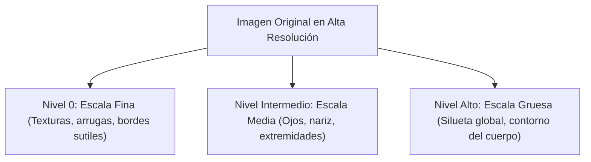
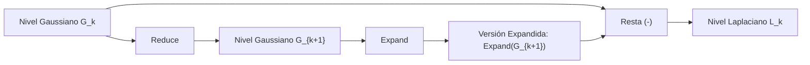
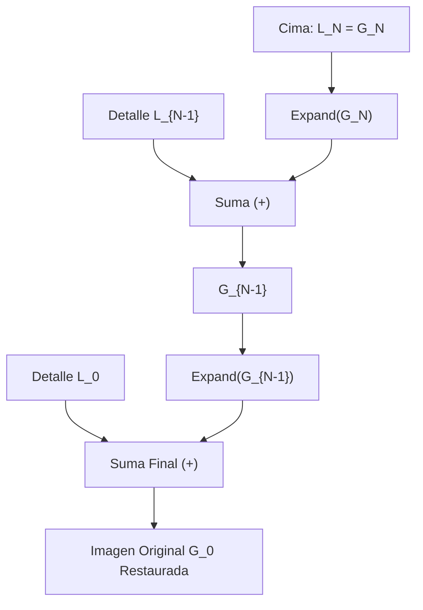
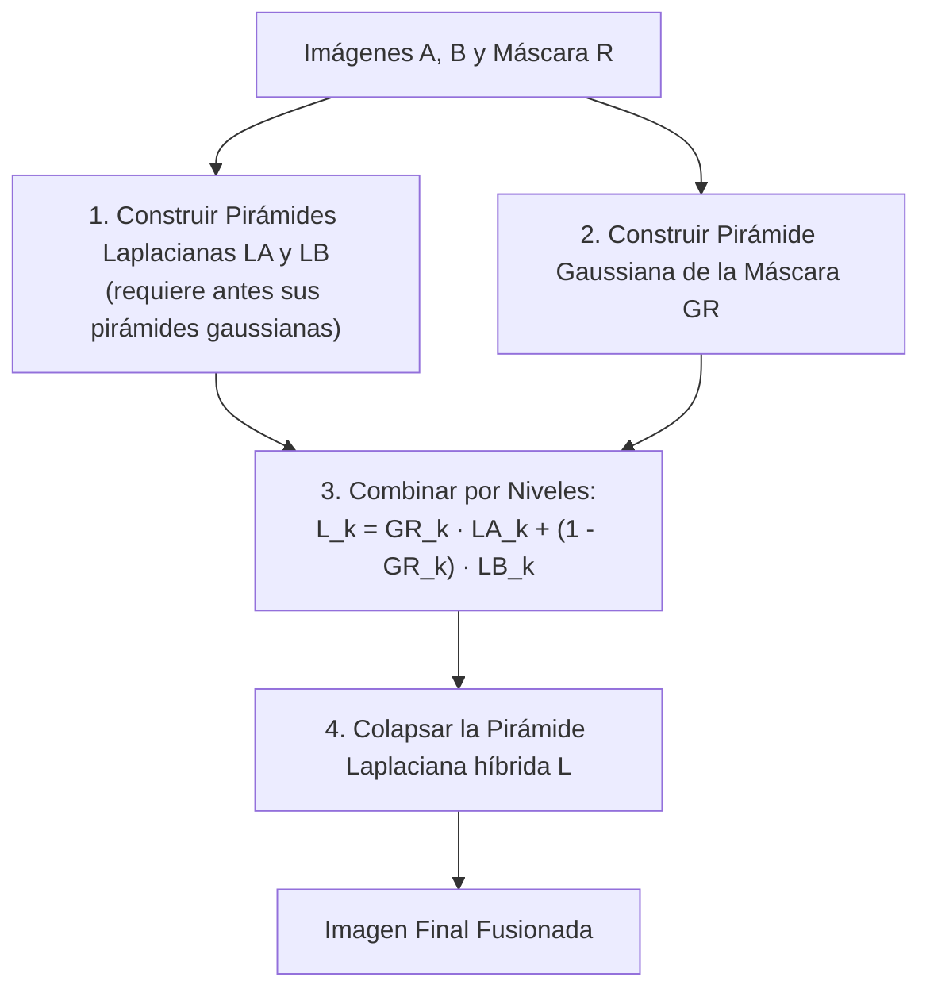
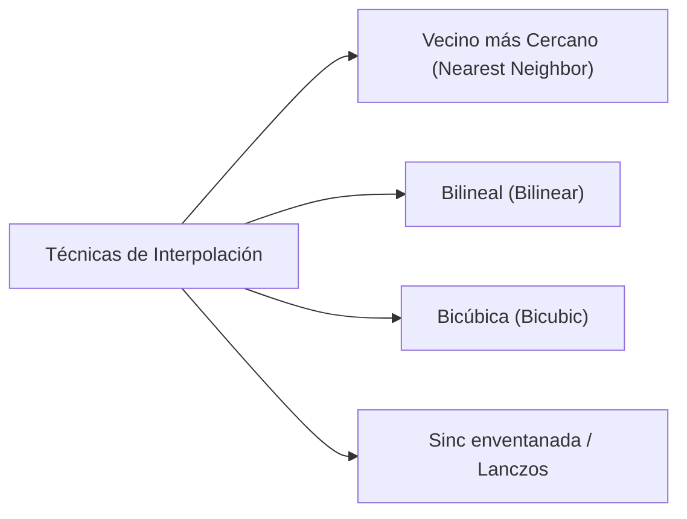

# 4. Pirámides de Imágenes y Teoría de Escala

Este documento desarrolla la teoría multirresolución y del espacio de escala (*scale-space*): por qué no existe una escala única correcta, cómo reducir una imagen sin introducir *aliasing* (submuestreo ingenuo frente a prefiltrado gaussiano), la formulación de las pirámides Gaussianas y Laplacianas (operadores `Reduce` y `Expand`, kernel binomial de Burt y Adelson), el teorema de reconstrucción exacta, sus aplicaciones canónicas (fusión multirresolución, compresión, imágenes híbridas, búsqueda en escala), y el problema inverso de aumentar el tamaño de una imagen: la interpolación entendida como reconstrucción mediante un *kernel de reconstrucción* (vecino más cercano, bilineal, bicúbica, sinc) y su implementación práctica (inserción de ceros, `cv2.pyrUp`, `cv2.resize`), con un apunte final sobre superresolución multi-imagen.

> [!info] Correspondencia con el material de clase
> Este bloque corresponde a las transparencias **T2.3 (Pyramids)**: *Image downsampling and aliasing*, *Image pyramids* (gaussianas, laplacianas y aplicaciones) y *Upsampling and interpolation*. La sección intermedia *Thinking in frequency* está desarrollada en [[3. Analisis de Frecuencia]].

---

## 1. La Necesidad del Análisis Multiescala

> "No single scale is categorically correct: the physical processes that generate signals such as images act at a variety of scales, and none is intrinsically more interesting or important than another." — Witkin (1984)

En el mundo físico, los objetos y las estructuras no poseen un tamaño fijo en la imagen proyectada:
- Un mismo rostro puede ocupar $500 \times 500$ píxeles (en primer plano) o solo $20 \times 20$ píxeles (a lo lejos).
- Un detector con kernel de tamaño fijo (ej. $5 \times 5$) sólo captura detalles a esa escala geométrica, fallando ante variaciones de distancia o resolución.
- En el hocico de una cebra (Forsyth & Ponce), un bloque de $8 \times 8$ píxeles contiene unos pocos pelos a escala fina, una raya completa a escala media y todo el hocico a escala gruesa. Para encontrar las rayas no queremos aplicar filtros enormes (lentos, costosos de construir y con "precisión espuria"): es más práctico **aplicar filtros pequeños a versiones suavizadas y remuestreadas** de la imagen.



La estructura más natural para operar a múltiples escalas es una **pirámide**. Mezclar características locales de varias escalas es un enfoque efectivo y coherente con el sistema visual humano (que también opera sobre una jerarquía de escalas, Marr 1982). Volveremos a estas ideas al estudiar la detección de puntos de interés y descriptores (p. ej. SIFT) en el Tema 3.

### Teoría del Espacio de Escala (*Scale-Space Theory*)
Introducida por Andrew Witkin (1983–84) y desarrollada por Tony Lindeberg (1988, 1994), establece que la familia de funciones gaussianas es la elección natural para generar una representación multiescala continua **sin introducir nuevas estructuras espurias** al aumentar la escala:

$$ L(x, y; \sigma) = I(x, y) * G_\sigma(x, y) $$

> [!info] Leyenda Matemática
> - $L(x, y; \sigma)$: Representación de la imagen a escala $\sigma$.
> - $G_\sigma$: Kernel gaussiano de desviación típica $\sigma$ (el parámetro de escala).
> - Las propiedades de semigrupo y separabilidad de la gaussiana ([[2. Gaussianas y Bordes]]) hacen que suavizar sucesivamente equivalga a suavizar una vez con una gaussiana más ancha: la base de la construcción recursiva de la pirámide.

---

## 2. Reducir una Imagen: Submuestreo y Aliasing

### El experimento de Van Gogh (S. Seitz)
Queremos una versión a la mitad de una imagen demasiado grande para la pantalla. La forma más inmediata: **descartar una de cada dos filas y columnas** (*image sub-sampling*). Repitiendo, obtenemos versiones a 1/4 y 1/8.

Al ampliarlas para verlas con detalle, la apariencia se degrada: aparecen saltos, patrones extraños y estructuras que **no estaban en la original**. Esto es **aliasing**: tras el muestreo, frecuencias diferentes se vuelven indistinguibles y aparecen como otras frecuencias (su *alias*). Es como si estuviéramos "inyectando altas frecuencias" (ruido).

> [!warning] Resumen del problema
> Al submuestrear por un factor de 2, la imagen original contiene frecuencias demasiado altas para la nueva resolución. La solución es el **anti-aliasing espacial**: suavizar con un filtro paso-baja **antes** de submuestrear, para eliminar las frecuencias que la nueva resolución no podrá representar. La justificación formal (Teorema de Nyquist, réplicas del espectro, Moiré, aliasing temporal) está en [[3. Analisis de Frecuencia]].

### Prefiltrado gaussiano (*Gaussian pre-filtering*)
**Solución: filtrar la imagen y después submuestrear.** Se usa un suavizado gaussiano porque su respuesta en frecuencia es más suave y se comporta mejor que un filtro de medias.

```text
   F0 ──(* H)──> blur ──(↓2)──> F1 ──(* H)──> blur ──(↓2)──> F2 ──> ...
```

Partimos de $F_0$ (original), la convolucionamos con el filtro gaussiano $H$, submuestreamos y obtenemos $F_1$. Repetimos: suavizamos $F_1$, submuestreamos, obtenemos $F_2$, y así sucesivamente. **La secuencia $F_0, F_1, F_2, \dots$ es la pirámide gaussiana.**

> [!example] Efecto del suavizado al construir la pirámide (bicicleta)
> - **Sin suavizado** (sólo conservar filas/columnas pares): ya en la tercera imagen aparecen artefactos de aliasing; en la cuarta y quinta son muy evidentes.
> - **Con suavizado gaussiano**: la tercera imagen tiene muchos menos artefactos y un aspecto natural. Al seguir reduciendo, la bicicleta se difumina y perdemos detalle, pero evitamos los artefactos bruscos.

---

## 3. La Pirámide Gaussiana (Burt & Adelson, 1983)

La **pirámide gaussiana** es una representación jerárquica discreta multirresolución donde cada nivel tiene la mitad de ancho y alto que el anterior (una **pirámide de octavas**, *octave pyramid*, porque niveles adyacentes están relacionados por un factor de muestreo $r = 2$).

```text
               Nivel 3 (64x64)      ▲ Escala gruesa (bajas frecuencias)
                 ┌────────┐         │
           Nivel 2 (128x128)        │  REDUCE:
            ┌────────────────┐      │  1. Suavizado paso-baja (G_σ)
       Nivel 1 (256x256)            │  2. Decimación espacial 2x
        ┌────────────────────────┐  │
   Nivel 0 (512x512) - Original     │
    ┌────────────────────────────────┐
                                    ▼ Escala fina (altas frecuencias)
```

> [!warning] Convención de la asignatura para contar niveles
> El **nivel 0 es la imagen original** y se cuenta aparte. Una "pirámide gaussiana de 4 niveles" contiene la original más 4 niveles obtenidos sucesivamente. **Si en las prácticas se pide una pirámide de 5 niveles, hay que visualizar 6 imágenes.** Torralba et al. usan la notación $\mathbf{g}_0 = \ell$ (original), $\mathbf{g}_1, \dots, \mathbf{g}_N$.

### El Operador `Reduce`
Para pasar del nivel $k$ al nivel $k+1$ se aplican dos pasos estrictamente en este orden:

$$ G_{k+1} = \operatorname{Reduce}(G_k) = \left( G_k * W \right) \downarrow 2 $$

1. **Filtrado Paso-Baja (Anti-Aliasing):** Burt y Adelson propusieron un kernel 1D de 5 coeficientes de la forma $[c, b, a, b, c]$ con $b = 1/4$ y $c = 1/4 - a/2$. En la práctica todo el mundo usa $a = 3/8$, que da el **kernel binomial** $\frac{1}{16}[1, 4, 6, 4, 1]$ (fácil de implementar con desplazamientos y sumas, importante cuando los multiplicadores eran caros). Se llama pirámide *gaussiana* porque las convoluciones repetidas del binomial convergen a una gaussiana. El kernel 2D es separable:
   $$ W = \frac{1}{256} \begin{bmatrix} 1 & 4 & 6 & 4 & 1 \\ 4 & 16 & 24 & 16 & 4 \\ 6 & 24 & 36 & 24 & 6 \\ 4 & 16 & 24 & 16 & 4 \\ 1 & 4 & 6 & 4 & 1 \end{bmatrix} = \frac{1}{16} \begin{bmatrix} 1 \\ 4 \\ 6 \\ 4 \\ 1 \end{bmatrix} \cdot \frac{1}{16} \begin{bmatrix} 1 & 4 & 6 & 4 & 1 \end{bmatrix} $$
2. **Submuestreo / Decimación ($\downarrow 2$):** Se descartan una de cada dos filas y columnas. En la práctica sólo se evalúa la convolución en las muestras que se conservan (convolución con *stride* 2):
   $$ G_{k+1}(i, j) = \sum_{m=-2}^2 \sum_{n=-2}^2 w(m, n) \, G_k(2i + m, 2j + n) $$

> [!info] Leyenda Matemática
> - $G_k$: Nivel $k$ de la pirámide gaussiana ($G_0$ = imagen original).
> - $W$, $w(m,n)$: Kernel binomial $5\times5$ normalizado (suma $1$, ganancia DC unitaria).
> - $\downarrow 2$: Operador de decimación por 2 (conservar índices pares).
> - En forma matricial (Torralba): $\mathbf{g}_{k+1} = \mathbf{D}_k \mathbf{B}_k \mathbf{g}_k$, donde $\mathbf{B}_k$ es la convolución binomial y $\mathbf{D}_k$ la decimación.

> [!tip] Calidad del filtro de decimación (Szeliski, Tabla 3.2)
> El binomial $[1,4,6,4,1]$ "corta muchas frecuencias" y es útil para pirámides de análisis en visión, pero **deja pasar bastante alta frecuencia**, lo que produce algo de aliasing al decimar. Para *blending* esto no importa. Si las imágenes reducidas se van a mostrar directamente (o mezclar entre resoluciones, como en el MIP-mapping de gráficos), conviene un filtro mejor: cúbico ($a=-1$ o $a=-0.5$), sinc enventanada, o los filtros de análisis QMF-9 / JPEG 2000.

### Sobrecoste de Memoria
A pesar de almacenar múltiples resoluciones, la pirámide gaussiana requiere poca memoria adicional gracias a la convergencia geométrica:

$$ \text{Memoria Total} = N^2 \left( 1 + \frac{1}{4} + \frac{1}{16} + \frac{1}{64} + \dots \right) = N^2 \sum_{k=0}^{\infty} \left(\frac{1}{4}\right)^k = N^2 \cdot \frac{1}{1 - 1/4} = \frac{4}{3} N^2 $$

> [!important] Huella de Memoria
> Cada nivel ocupa $1/4$ del anterior (mitad de filas y mitad de columnas). En el límite de infinitos niveles, toda la pirámide ocupa como máximo un **$33.3\%$** más que la imagen original. Las pirámides son por tanto **sobrecompletas** (*overcomplete*): usan más coeficientes que píxeles, a diferencia de las *wavelets*, que mantienen el mismo número.

---

## 4. La Pirámide Laplaciana

Mientras que la pirámide gaussiana almacena versiones progresivamente suavizadas (paso-baja), la **pirámide laplaciana** almacena, en cada nivel, **lo que está presente en un nivel gaussiano pero no en el siguiente** (la información de detalle, paso-banda) que se pierde entre un nivel y el siguiente.



### Construcción paso a paso (de arriba abajo)
1. Partimos de la **imagen más pequeña** de la pirámide gaussiana. Se conserva tal cual: **la cima de la pirámide gaussiana y la de la laplaciana son la misma imagen** (el *residuo paso-baja*, *low-pass residual*).
2. La **expandimos** hasta el tamaño del nivel gaussiano inmediatamente inferior y **restamos** esa imagen expandida de dicho nivel gaussiano. Obtenemos el nivel $L_i$ de la laplaciana: el detalle perdido al pasar de un nivel al siguiente.
3. Pasamos al siguiente nivel gaussiano, lo expandimos, restamos, y ya tenemos $L_{i-1}$.
4. Y así sucesivamente hasta la base.

> [!info] Cuántos niveles hacen falta
> Para construir una pirámide laplaciana de $N$ niveles hace falta una pirámide gaussiana de $N+1$ niveles: el último es el residuo paso-baja.

### El Operador `Expand`
Para comparar un nivel reducido $G_{k+1}$ con su predecesor $G_k$ es necesario duplicar sus dimensiones:

$$ \operatorname{Expand}(G)(i, j) = 4 \sum_{m=-2}^2 \sum_{n=-2}^2 w(m, n) \, G\left( \frac{i-m}{2}, \frac{j-n}{2} \right) $$

1. **Upsampling (inserción de ceros):** Se insertan filas y columnas alternas de ceros entre las muestras originales. Sólo **una de cada cuatro** posiciones de la nueva rejilla contiene un valor original; las otras tres contienen cero.
2. **Interpolación:** Se convoluciona con el **mismo** filtro gaussiano/binomial usado en `Reduce`, multiplicado por $4$.

> [!important] ¿Por qué multiplicar por 4?
> El kernel gaussiano es un filtro de suavizado que suma $1$. Pero $3/4$ de la imagen expandida es cero, así que la intensidad media cae a la cuarta parte: un píxel de valor $100$ se convierte en el bloque $[100, 0, 0, 0]$, cuya media es $25$. Hace falta un **factor externo $\times 4$ para recuperar el brillo original**. (En 1D el factor es $2$: Szeliski señala que los coeficientes del filtro de reconstrucción son el doble de los de análisis, y Torralba escribe $\mathbf{F}_k = 2\,\mathbf{B}_k \mathbf{U}_k$.) Este es exactamente el procedimiento de `cv2.pyrUp()`.

### Definición Analítica del Nivel Laplaciano
$$ L_k = G_k - \operatorname{Expand}(G_{k+1}) $$

El último nivel de la pirámide laplaciana (la cima) es directamente la imagen más pequeña de la pirámide gaussiana:
$$ L_N = G_N $$

> [!info] Leyenda Matemática
> - $L_k$: Nivel $k$ de la pirámide laplaciana (imagen de detalle, con valores positivos y negativos concentrados alrededor de $0$).
> - $\operatorname{Expand}(G_{k+1})$: Versión paso-baja reconstruida del nivel $k$ (aún más suavizada que $G_k$ por el viaje de ida y vuelta).
> - En forma matricial (Torralba): $\mathbf{l}_k = \mathbf{g}_k - \mathbf{F}_k \mathbf{g}_{k+1} = (\mathbf{I} - \mathbf{F}_k \mathbf{G}_k)\,\mathbf{g}_k$.

### ¿Por qué se llama "laplaciana"?
El nombre es un ligero abuso: cada nivel es en realidad la **diferencia de dos versiones gaussianas** de la imagen (una **Diferencia de Gaussianas, DoG**), y en [[2. Gaussianas y Bordes]] vimos que la DoG aproxima la Laplaciana de la Gaussiana ($\nabla^2 G$). Es decir, la pirámide laplaciana es un banco de filtros DoG/LoG muestreado a distintas escalas. Szeliski muestra (Fig. 3.34) que la diferencia de dos paso-baja es un paso-banda que se ajusta muy bien a una LoG de media octava.

> [!tip] Variante sin aliasing (Szeliski)
> Burt y Adelson también describen una variante en la que la imagen paso-baja que se resta es la **imagen suavizada original** (sin decimar y re-expandir). Tiene menos aliasing, pero **no es auto-invertible**: las imágenes laplacianas ya no bastan para reconstruir la original.

---

## 5. Reconstrucción Exacta sin Pérdidas (*Lossless Collapse*)

La pirámide laplaciana **permite recuperar la imagen original exactamente, píxel a píxel**, siempre que se use en la reconstrucción la **misma operación de expansión** que en la construcción. Es pura aritmética: lo que antes restamos, ahora lo sumamos.

$$ G_k = L_k + \operatorname{Expand}(G_{k+1}), \qquad k = N-1, \dots, 0 $$



> [!example] Pequinés
> Con una pirámide gaussiana de 4 niveles del pequinés, su laplaciana correspondiente y la reconstrucción: **todos los píxeles de la imagen reconstruida coinciden con los de la original**. Tenemos una versión reducida más todos los detalles (altas frecuencias) a distintas escalas: toda la información necesaria.

> [!important] Propiedades de la reconstrucción
> - La reconstrucción exacta **no depende de los filtros** empleados en `Reduce`/`Expand`: incluso con filtros aleatorios seguiría siendo exacta (Torralba et al.), siempre que se conserve el residuo paso-baja.
> - La arquitectura tiene dos partes: una **red de análisis (codificador)** que transforma la imagen en $\{L_0, L_1, \dots, G_N\}$ y una **red de síntesis (decodificador)** que la reconstruye. Codificador y decodificador son también los bloques básicos de las redes neuronales profundas: la pirámide laplaciana puede verse como un tipo especial de red profunda.

> [!important] Naturaleza Paso-Banda de la Pirámide Laplaciana
> La pirámide laplaciana es una descomposición por bandas de frecuencia:
> - $L_0$ contiene los bordes y texturas ultrafinas.
> - $L_1$ contiene estructuras y transiciones medias.
> - $L_N$ (residuo) contiene la iluminación global y fondos planos.

---

## 6. Aplicaciones de las Pirámides

Las pirámides aparecen en multitud de tareas a lo largo de la historia de la visión: compresión, *blending*, imágenes híbridas, detección y registro multiescala, aceleración de búsquedas *coarse-to-fine*, MIP-mapping en gráficos, manipulación de contraste local y *tone mapping* de HDR (*local Laplacian filters*, Paris et al. 2011).

### 6.1 Fusión Multirresolución (*Multiresolution Spline Blending*)
Burt y Adelson (1983) resolvieron el problema de unir dos imágenes (la manzana y la naranja; un panorama) eliminando la costura visible sin generar dobles imágenes fantasma (*ghosting*). La clave: las variaciones de **baja frecuencia** (color global de la manzana roja y la naranja) se mezclan **suavemente en una franja ancha**, mientras que las texturas de **alta frecuencia** se mezclan **en una franja estrecha** para que no se superpongan.

```text
               Problemas del Blending Simple:
   Corte Abrupto (Costura dura)          Transición Lineal (Costura fantasma)
   ┌──────────┬──────────┐               ┌──────────░░░░──────────┐
   │ Imagen A │ Imagen B │               │ Imagen A ░░░░ Imagen B │
   └──────────┴──────────┘               └──────────░░░░──────────┘
      Línea de unión visible               Doble exposición en el borde
```

La solución ingenua $\ell_{out} = \ell^A \cdot m + \ell^B \cdot (1-m)$ con una máscara binaria produce una transición brusca.

#### Algoritmo Paso a Paso
Dadas dos imágenes $A$ y $B$, y una máscara binaria $R$ ($R=1$ donde se toma $A$ y $R=0$ donde se toma $B$):



1. **Pirámides Laplacianas:** Construir $LA$ a partir de $A$ y $LB$ a partir de $B$ (para ello hay que calcular primero sus pirámides gaussianas).
2. **Pirámide Gaussiana de la Máscara:** Construir $GR$ a partir de $R$. Al suavizarse la máscara con gaussianas de escala creciente, la anchura de la franja de transición se adapta automáticamente al tamaño de las estructuras de cada nivel $k$. (Torralba et al. construyen la pirámide de la máscara con **un nivel más** que las laplacianas, para ponderar también el residuo.)
3. **Mezcla Nivel a Nivel:**
   $$ L_k(i, j) = GR_k(i, j) \cdot LA_k(i, j) + \left(1 - GR_k(i, j)\right) \cdot LB_k(i, j) $$
   Lo mismo para el residuo paso-baja.
4. **Reconstrucción:** Colapsar la pirámide combinada $L$ mediante `Expand` y suma.

> [!info] Leyenda Matemática
> - $LA_k, LB_k$: Nivel $k$ de las laplacianas de $A$ y $B$.
> - $GR_k$: Nivel $k$ de la gaussiana de la máscara, con valores en $[0,1]$ que actúan como **pesos** suaves.
> - $L_k$: Nivel $k$ de la laplaciana híbrida.

> [!example] Ejemplos y límites
> - Manzana y naranja; un ojo sobre una mano con máscara ovalada; la cara de Selena Gomez sobre la de Jonah Hill con máscara facial.
> - La máscara no tiene por qué ser rectangular, y el método se extiende a un número arbitrario de imágenes con una imagen de etiquetas enteras (Szeliski, Ex. 3.18). Es muy usado en *stitching* y composición de panoramas; variantes posteriores: *Poisson blending* y mezcla en el dominio del gradiente.
> - **Falla** cuando la mezcla requiere transformaciones geométricas (imágenes mal alineadas) o cuando la composición de la escena no cuadra.

### 6.2 Compresión de Imágenes (Burt & Adelson, 1983)
Para reconstruir la imagen original $x_1$ basta almacenar $L_1, L_2, L_3$ y $g_3$ (el residuo). ¿Por qué comprime?
- El **histograma de la imagen original** cubre muchos niveles de gris: alta variabilidad, **entropía** alta (7.57 bits/píxel en el ejemplo; el máximo sería 8 con 256 niveles equiprobables). La entropía del histograma es el número mínimo medio de bits por píxel para codificar la imagen sin pérdida.
- Los **niveles laplacianos** almacenan diferencias entre escalas: valores positivos y negativos **concentrados alrededor de $0$**, porque en muchas regiones la predicción desde el nivel superior es muy buena. Sus histogramas son mucho más estrechos: entropías de 4.48, 5.01, 5.63 y 6.21 en el ejemplo. Y aunque la entropía suba en niveles superiores, esas imágenes son cada vez más pequeñas.
- **Cuantización:** Representar conjuntos de valores próximos con un mismo valor reduce aún más la entropía (4.48 → 0.77, 5.01 → 1.99, 5.63 → 3.36, 6.21 → 4.71). Ahora la compresión es **con pérdida**.
- Resultado: en lugar de 7.57 bits/píxel, toda la pirámide cuantizada necesita unos **1.58 bits/píxel** (≈ 20.9 % del tamaño original, una reducción de ≈ 79 %), y las imágenes reconstruidas son prácticamente indistinguibles de las originales.

### 6.3 Imágenes Híbridas (Oliva, Torralba & Schyns, 2006)
Mezclando las **altas frecuencias de una imagen** con las **bajas frecuencias de otra** se obtiene una imagen que admite interpretaciones distintas según la distancia de observación: de cerca domina la componente de alta frecuencia (p. ej. una cara neutra), de lejos la de baja frecuencia (una cara enfadada).

> [!tip] Las altas frecuencias dominan a corta distancia; las bajas, a larga distancia
> El resultado se evalúa precisamente con una **pirámide gaussiana**: al avanzar hacia niveles más suavizados vamos eliminando altas frecuencias y observamos qué componente sigue siendo perceptible, simulando el alejamiento.

### 6.4 Búsqueda en Escala y Búsqueda Espacial (Forsyth & Ponce)
- **Búsqueda en escala:** Muchos objetos (una cara frontal: dos pozos oscuros para los ojos bajo una barra oscura de cejas, una barra clara en la nariz, una barra oscura en la boca) tienen un patrón distintivo a baja resolución. Los detectores asumen un rango pequeño de escalas; **para encontrar caras más grandes se busca en niveles más gruesos y para caras más pequeñas en niveles más finos**.
- **Búsqueda espacial (*coarse-to-fine*):** En estéreo o movimiento buscamos el punto de una segunda imagen que corresponde a uno de la primera. Buscar en la resolución original es ineficiente; es mejor encontrar primero una correspondencia aproximada a escala gruesa y refinarla en la vecindad a escalas más finas.

---

## 7. Aumentar una Imagen: Interpolación

Empezamos el bloque reduciendo el Van Gogh; ahora el problema opuesto: **aumentar** una imagen demasiado pequeña (×10, por ejemplo). La estrategia más simple: repetir cada fila y columna 10 veces (cada píxel pasa a ser un bloque $10\times10$): es la **interpolación por vecino más cercano**, rápida pero pixelada, porque no crea transiciones nuevas entre los valores originales.

### 7.1 La interpolación como reconstrucción
Una imagen digital $F[x,y]$ es un **muestreo discreto** de una función continua $f(x,y)$ (con intervalo de muestreo $d$: cuanto menor $d$, mayor frecuencia de muestreo). Si pudiéramos reconstruir la función continua, podríamos generar una imagen nueva **a cualquier resolución y escala**: aumentar la resolución consiste en estimar qué valores tendría $f$ entre las muestras y evaluarla en nuevas posiciones.

Pero no conocemos $f$, así que **la aproximamos de forma principiada: filtrando**.
1. Colocamos las muestras conocidas en sus posiciones y dejamos a cero las intermedias.
2. Convolucionamos con un **filtro de reconstrucción** $h$: cada muestra genera una copia desplazada del kernel, escalada por su valor, y la suma de todas las contribuciones es la señal reconstruida.

$$ g(i) = \sum_k f(k) \, h(i - rk) $$

> [!info] Leyenda Matemática
> - $f(k)$: Muestras de la imagen de entrada.
> - $r$: Factor de aumento (*upsampling rate*).
> - $h$: Kernel de interpolación (reconstrucción). Si $h$ es un kernel de suavizado de área unidad, hay que escalarlo por $r$ para convertirlo en interpolador.
> - $g(i)$: Valor interpolado en la posición $i$ de la rejilla ampliada. Equivalentemente (forma *polyphase*), el kernel centrado en la salida $i$ pondera las entradas.

> [!example] Ejemplo de clase (Snavely)
> Muestras $F = [2, 0, 1.5]$ en $x = 1, 2, 3$ con $d=1$; queremos el valor en $x = 2.5$. Con el filtro triangular $h = [0.5, 1, 0.5]$, las dos muestras vecinas ($2$ y $1.5$) reciben peso $0.5$ cada una: $0.5 \cdot 2 + 0.5 \cdot 1.5 = 1.75$. Es exactamente una interpolación lineal entre ambas.

### 7.2 Catálogo de kernels de reconstrucción
Los distintos métodos sólo se diferencian en **qué filtro de reconstrucción** usan:

| Kernel de reconstrucción $h$ | Método resultante | Carácter de la reconstrucción |
| :--- | :--- | :--- |
| **Caja** (rectangular) | Vecino más cercano | A trozos constante. |
| **Tienda** (triangular) | Lineal / bilineal | A trozos lineal; "pliegues" (*creases*) visibles en imágenes. |
| **Gaussiana** | Reconstrucción gaussiana | Suave; es *aproximante* (no pasa exactamente por las muestras). |
| **Sinc** | Reconstrucción **ideal** (paso-baja ideal, respuesta rectangular en frecuencia) | Exacta para señales limitadas en banda, pero soporte infinito y *ringing*. |



| Método | Soporte Espacial | Complejidad | Calidad Visual y Propiedades |
| :--- | :---: | :---: | :--- |
| **Vecino más Cercano** | $1 \times 1$ píxel | $\mathcal{O}(1)$ | $\ell_{out}(a,b) = \ell_{in}[\text{round}(a), \text{round}(b)]$. Bloques y bordes pixelados. Muy usado como método de *forward mapping* ingenuo. |
| **Bilineal** | $2 \times 2$ ($4$ vecinos) | Moderada | Interpola linealmente primero en una dirección y luego en la otra: $f(x, y) \approx (1-u)(1-v)I_{00} + u(1-v)I_{10} + (1-u)v I_{01} + uv I_{11}$. Suave pero desenfoca ligeramente. Es el kernel de las tarjetas gráficas (con MIP-map). |
| **Bicúbica** | $4 \times 4$ ($16$ vecinos) | Alta | Spline cúbica a trozos $C^1$ con parámetro $a$ (derivada en $x=1$). $a=-1$ imita la respuesta de la sinc y afila un poco (pero no interpola rampas exactamente: algo de *ringing*); $a=-0.5$ reproduce exactamente funciones lineales y cuadráticas (mejor para grandes aumentos). Estándar en edición fotográfica ("elección común"). |
| **Sinc enventanada / Lanczos** | 9+ *taps* | Alta | Considerada la de mayor calidad: preserva detalle y evita aliasing, a costa de *ringing* repetitivo que a algunos les molesta. |

> [!warning] Aumentar no crea información
> Al ampliar **no recuperamos detalle que no existía**. Los métodos sólo estiman de distinta forma los nuevos píxeles: la imagen puede verse más suave o menos pixelada, pero no contiene más información real. Crear detalles nuevos es otro problema: la **superresolución** (§8). Además, para aumentar una señal 4 veces con buena calidad algunos fotógrafos prefieren interpolar repetidamente en pequeñas fracciones, para decorrelar la rejilla original de la final.

### 7.3 Implementación: inserción de ceros + convolución
Cuando el factor $k$ es entero, el *upsampling* se implementa en dos pasos lineales:

$$ z[n,m] = \ell_{in}[n,m] \uparrow k \;\;(\text{expansión: insertar } k-1 \text{ ceros entre muestras}) \qquad \ell_{out} = z * h_k \;\;(\text{interpolación}) $$

Para $k=2$ el kernel **bilineal 1D** es el binomial $[1/2, 1, 1/2]$ y en 2D su producto exterior:

$$ h_{bilineal} = \begin{bmatrix} 1/2 \\ 1 \\ 1/2 \end{bmatrix} \begin{bmatrix} 1/2 & 1 & 1/2 \end{bmatrix} = \begin{bmatrix} 1/4 & 1/2 & 1/4 \\ 1/2 & 1 & 1/2 \\ 1/4 & 1/2 & 1/4 \end{bmatrix} $$

> [!example] Pregunta de clase: ¿cuál es el efecto principal del filtro anterior?
> (a) Suavizado gaussiano, (b) Detección de bordes, **(c) Interpolación bilineal**, (d) Ninguna.
> Aplicado a una imagen con ceros intercalados (`10 0 20 0 30 ...`), asigna peso $1$ al píxel original, $1/2$ a los vecinos horizontales/verticales y $1/4$ a los diagonales: **rellena los huecos con combinaciones lineales de los vecinos**. El kernel es separable ($[1/2, 1, 1/2]$ consigo mismo). Nótese que su suma es $4$ (no $1$): es el factor que compensa los $3/4$ de ceros, igual que en `Expand`.

El kernel de **vecino más cercano** para $k=2$ es $h[n] = [1, 1]$ (replicar la muestra). Torralba et al. señalan que el binomial no es el mejor interpolador (no suprime del todo las réplicas espectrales que aparecen al insertar ceros), pero es muy eficiente y el resultado es razonablemente bueno.

### 7.4 Nota técnica: funciones de OpenCV
| Función | Qué hace | Uso típico |
| :--- | :--- | :--- |
| `cv2.pyrUp` | Expande la imagen (inserción implícita de ceros) y suaviza con el kernel gaussiano, compensando el factor de escala. | Construir y reconstruir la **pirámide laplaciana**. |
| `cv2.pyrDown` | Suaviza con gaussiana y después submuestrea (anti-aliasing incluido). | Construir la **pirámide gaussiana**. |
| `cv2.resize` | Cambio de tamaño general. **Upsampling:** calcula directamente cada píxel de salida con el método elegido (`INTER_NEAREST`, `INTER_LINEAR`, `INTER_CUBIC`, `INTER_LANCZOS4`...), sin insertar ceros explícitamente. **Downsampling:** el comportamiento depende del método; `INTER_AREA` es el recomendado porque promedia áreas de píxeles fuente (anti-aliasing), mientras que vecino más cercano **no filtra**. | Redimensionado genérico. |

### 7.5 Interpolación en transformaciones geométricas
La interpolación no sirve sólo para cambiar de tamaño: toda **transformación geométrica** (rotación, homografía) la necesita. Los píxeles de salida están en una rejilla entera, pero al aplicar la transformación inversa el píxel $(20, 30)$ de salida puede proceder de la posición $(12.4, 17.7)$ de la original, donde no hay ningún píxel: se estima a partir de $(12,17), (12,18), (13,17), (13,18)$.

> [!tip] Forward vs backward mapping (Torralba et al.)
> Mapear cada píxel de entrada hacia la salida (*forward mapping*) deja huecos y produce aliasing. Lo correcto es el ***backward mapping***: recorrer los píxeles de **salida**, aplicar la transformación inversa $\mathbf{M}^{-1}$ e interpolar en la entrada. Si la densidad de píxeles de salida es menor que la de entrada, hay que suavizar antes para evitar aliasing (misma lógica que al decimar).

---

## 8. Más Allá de la Interpolación: Superresolución

- **Aprendizaje profundo:** Modelos como ESRGAN (Wang et al., 2018) aprenden a *inventar* detalle plausible a partir de datos; ya no es una regla fija sobre los vecinos.
- **Superresolución multi-imagen:** Si disponemos de **varias capturas con pequeños desplazamientos** (una ráfaga), cada una muestrea posiciones ligeramente distintas de la escena, y esa información complementaria **sí permite recuperar detalle real**. El *Super Res Zoom* del Google Pixel 3 aprovecha el **temblor natural de la mano** como fuente de desplazamientos subpíxel: tras alinear globalmente la ráfaga, fusiona los fotogramas directamente sobre una rejilla de mayor resolución (*multi-frame super-resolution*), reduciendo además el ruido y la cantidad de color que hay que inferir en el *demosaicing* del patrón Bayer.

---

## 9. Resumen del Bloque (transparencias T2.3)

- Submuestrear una imagen puede causar **aliasing**. Mejor **suavizar (prefiltrar)** para eliminar altas frecuencias y después submuestrear.
- Si se repite "suavizar y submuestrear por 2", se obtiene una **pirámide gaussiana**.
- De la gaussiana se calcula la **pirámide laplaciana**, útil en *blending* y compresión, con **reconstrucción exacta**.
- Aumentar una imagen requiere **interpolación**, que puede plantearse como convolución con un **kernel de reconstrucción**.

> [!tip] Vídeos de repaso recomendados (Steve Seitz, "The Case of the Splotched Van Gogh")
> *Images in 5 minutes* (Part 1), *Image filtering in 5 minutes* (Part 2), *Fourier Transform in 5 minutes* (Part 3), *Color Perception in 5 minutes* e *Interpolation in 5 minutes*.

---

## 10. Conexión Conceptual con el Temario

- **Fundamentos Previos:** En [[1. Representacion y Filtrado]], aprendimos las propiedades básicas de los sistemas lineales y las operaciones de convolución (aquí usadas con *stride* y con inserción de ceros).
- **Operadores Diferenciales:** En [[2. Gaussianas y Bordes]], vimos que la DoG aproxima a la LoG; cada nivel de la pirámide laplaciana es una DoG a una escala.
- **Teoría Espectral:** En [[3. Analisis de Frecuencia]], formalizamos el Teorema de Nyquist y los filtros *anti-aliasing* que fundamentan el operador `Reduce`, y la respuesta en frecuencia de los kernels de reconstrucción.
- **Casos Prácticos de Examen:** En [[5. Ejercicios y Preguntas de Examen]], encontrarás ejercicios sobre el filtro bilineal, el factor $\times 4$ de `Expand`, la memoria de la pirámide y la convención de niveles.

---

### 📚 Referencias Bibliográficas

- **Szeliski, Richard** (2022). *Computer Vision: Algorithms and Applications* (2nd ed.). Springer.
  - **Capítulo / Sección:** Chapter 3: Image processing $\to$ Section 3.5: *Pyramids and wavelets* (3.5.1 Interpolation, 3.5.2 Decimation, 3.5.3 Multi-resolution representations, 3.5.5 Application: Image blending). Páginas 139–154 del PDF.
  - **Archivo local:** [[docs_clase/textBook/Szeliski/Chapter_3_Image_processing/3.5_Pyramids_and_wavelets.md|Szeliski - Chapter 3.5 Pyramids and wavelets]].
- **Forsyth, David A.; Ponce, Jean** (2012). *Computer Vision: A Modern Approach* (2nd ed.). Pearson.
  - **Capítulo / Sección:** Chapter 4: Linear Filters $\to$ Section 4.7: *Technique: Scale and Image Pyramids* (4.7.1 The Gaussian Pyramid, Algorithm 4.2; 4.7.2 Applications of Scaled Representations). Páginas 166–168 del PDF.
  - **Archivo local:** [[docs_clase/textBook/Forsyth_Ponce/4_Linear_Filters/4.7_Technique_Scale_and_Image_Pyramids.md|Forsyth & Ponce - Chapter 4.7 Scale and Image Pyramids]].
  - **Capítulo / Sección:** Chapter 4: Linear Filters $\to$ Section 4.4.3: *Smoothing and Resampling* (Algorithm 4.1). Páginas 153–162 del PDF.
  - **Archivo local:** [[docs_clase/textBook/Forsyth_Ponce/4_Linear_Filters/4.4_Sampling_and_Aliasing.md|Forsyth & Ponce - Chapter 4.4 Sampling and Aliasing]].
- **Torralba, Antonio; Isola, Phillip; Freeman, William T.** (2024). *Foundations of Computer Vision*. MIT Press.
  - **Capítulo / Sección:** Image Pyramids $\to$ *Gaussian Pyramid*, *Laplacian Pyramid* (forma matricial, factor $2$, residuo paso-baja, codificador/decodificador) e *Image Blending*.
  - **Archivo local:** [[docs_clase/textBook/Torralba_Foundations/pyramids_new_notation.md|Torralba - Image Pyramids]].
  - **Capítulo / Sección:** Downsampling and Upsampling Images $\to$ *Downsampling*, *Anti-Aliasing Filters*, *Upsampling* (Nearest Neighbor, Linear and Bilinear Interpolation, Expansion, Interpolation Filters).
  - **Archivo local:** [[docs_clase/textBook/Torralba_Foundations/upsamplig_downsampling_2.md|Torralba - Downsampling and Upsampling Images]].
  - **Capítulo / Sección:** Representing Images and Geometry $\to$ *Image Warping* (forward vs backward mapping) e *Interpolation*.
  - **Archivo local:** [[docs_clase/textBook/Torralba_Foundations/homogeneous_coordinates.md|Torralba - Homogeneous Coordinates and Image Warping]].
- **Material Oficial Docente UGR** (2026). *Transparencias y Anotaciones de Clase de Visión por Computador: T2.3 Pyramids*. Pablo Mesejo, Departamento de Ciencias de la Computación e Inteligencia Artificial, Universidad de Granada.
  - **Archivo local:** [[docs_clase/T2/2.3.Pyramids_comentada.pdf|Transparencias T2.3 (comentadas)]].
- **Burt, Peter J.; Adelson, Edward H.** (1983). *The Laplacian Pyramid as a Compact Image Code*. IEEE Transactions on Communications, 31(4), 532-540.
- **Burt, Peter J.; Adelson, Edward H.** (1983). *A multiresolution spline with application to image mosaics*. ACM Transactions on Graphics (TOG), 2(4), 217-236.
- **Oliva, Aude; Torralba, Antonio; Schyns, Philippe G.** (2006). *Hybrid Images*. ACM Transactions on Graphics (SIGGRAPH).
- **Witkin, Andrew** (1984). *Scale-space filtering: A new approach to multi-scale description*. ICASSP'84. **Lindeberg, Tony** (1994). *Scale-space theory: A basic tool for analyzing structures at different scales*. Journal of Applied Statistics, 21(1-2), 225-270.
